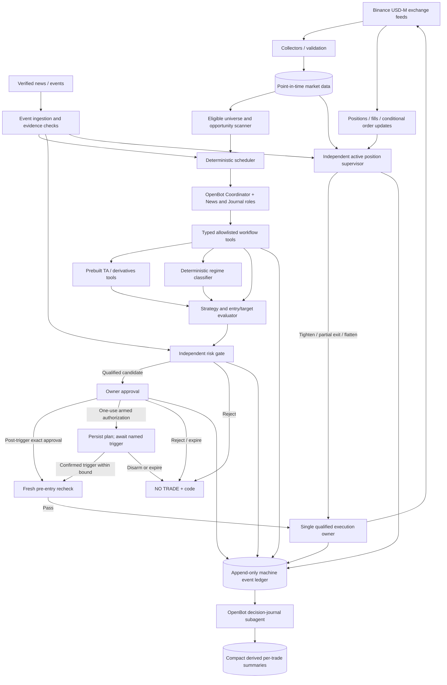

# Agentic Crypto Futures Trading System

**Consolidated, consultation-amended engineering specification — Version 1.5 (reuse-first, bounded agent coordination, Binance integration, research-led delivery)**  
**Date:** 24 October 2026  
**Status:** **Consultation-amended design baseline / CONDITIONAL GO for bounded research and integration feasibility only.** Not installed, experimentally integrated, profit-validated or authorized for live trading. All listed thresholds are research hypotheses unless explicitly identified as safety ceilings.  
**Audience:** Owner, integrating engineers, research/quant reviewers, security reviewers, and operators

**Document-control rule:** This specification is authoritative for **intended behavior**. A repository name is not authorization to deploy it. Every adopted dependency must have a recorded version, functional test result, owner, and rollback plan.

---

**Scope clarification (v1.5):** **ALL TEN analytical families (A01–A10), including order flow/footprint/CVD, remain in final product scope.** The narrow SMC+VWAP wiring test is not an implied final strategy scope. The original v1.4.1 material is retained and amended in place. Source of amendments: *Final Consultation: Agentic Crypto Futures Trading System*, dated 24 October 2026; see §20.

## v1.5 change-control and interpretation (binding)

This is a **complete v1.5 specification derived from the intact v1.4.1 baseline**; unchanged component research, prior acceptance tests, deployment concepts and source references remain relevant. Consultation recommendations were accepted only where identified below and in the amended clauses. The v1.5 text in a section supersedes any earlier prototype statement in that section. No untested strategy change becomes trade-ready by being described here.

**Six high-priority amendments:**
1. **Economics before build-out:** distinguish gross price-risk (`d0_price`), planned target-scenario net reward/risk (`scenario_net_RR`), realized `net_R` and historical expectancy. Diagnose B1's 40% at 1R / 60% at 2R ladder before promoting it.
2. **Persistent setup states:** separate setup event lifecycles from regime labels; preserve/replay T1 reclaim chronology, R1 frozen range and B1 retest windows.
3. **Human-approved armed plans:** evaluate as a preferred experimental authorization path alongside the earlier post-trigger approval path, preserving one explicit approval for each bounded new trade.
4. **Durable execution:** persistent exit latch, one writer, per-account atomic reservations, unknown-submission reconciliation, late-entry-fill recovery, and never cancelling the only verified stop to tighten it.
5. **Data and selection realism:** symbol/feature readiness, trade-derived versus approximate indicators, cohort qualification, joint market-time validation, and full universe→approval→fill funnel tracking.
6. **Lean delivery:** only three live OpenBot roles (Coordinator, News/Events, Journal); all other specialist analysis runs as deterministic tools. Run data/friction research and a short execution-owner feasibility comparison *before* building the full platform.

**Delivery status labels:** `DESIGN_BASELINE` means explicitly specified; `RESEARCH_CANDIDATE` means not economically qualified; `INTEGRATION_CANDIDATE` means technically unverified; `QUALIFIED` requires the recorded tests; `LIVE_ENABLED` requires a separate owner promotion record. References to a "final" document mean architectural control, never performance proof.

## Reader guide / table of contents

- **§0–3:** Binding system charter, responsibilities and OpenBot-native agent workflow.
- **§4–5:** Binance data, altcoin/news discovery, all ten analytic families, and the prebuilt-component **selection matrix**.
- **§6–8:** Explicit regime, sniper entry/TP, strategy qualification, decision and risk algorithms.
- **§9–12:** Human approval, Binance execution, **active position supervision**, typed contracts and concise decision journaling.
- **§13–14:** Backtesting, component compatibility, active-management fault tests and release criteria.
- **§15–20:** Economics-first staged assembly plan, unresolved validation gates, repository structure, glossary, final contract and source evidence.
- **§2.3 and §5.4–5.5:** Final Binance integration decision, adapter boundaries, exact proof-of-concept tests, and fallback rules.

**If you are implementing this:** Read §0.2, §2.3, §5.2–5.5 and §7.7 **before writing code**. They prevent accidental reinvention of existing capabilities.

---

## 0. Executive decision

We will **assemble mostly prebuilt software** into an **LLM-orchestrated, rules-driven crypto perpetual-futures trading system with mandatory human approval before every new entry or position increase**. The LLM is compulsory for coordinating a *new-trade workflow*, but **does not calculate indicators, invent strategies, determine position size, bypass safety limits, or directly place orders**. A deterministic decision engine evaluates signals. An independent risk engine approves their safety. The owner approves a **specific, time-bounded proposal or tightly constrained armed conditional plan**. Only then may the execution owner submit the permitted order after trigger and fresh checks. Protective exits are automatic and **must remain operational even if the LLM fails**.

> **Operating contract:** The **LLM coordinates**. Analytical engines **calculate**. The decision engine **selects**. The risk engine **constrains**. The human **authorizes**. The execution engine **executes and protects**.

**REUSE-FIRST IS MANDATORY:** Search for, compare, test, and integrate existing software before proposing any new calculator, indicator, scanner, trade-execution library or agent tool. New code should be limited to thin adapters, precise decision algorithms not already available, approval/security glue and unavoidable safety controls. No percentage-of-code-reused target is claimed.

No software or indicator in this specification is represented as proven profitable. Source projects are candidates for engineering assessment, not endorsements or deployed dependencies. Futures carry substantial risk, including liquidation and losses exceeding expectations during volatile conditions.

### 0.1 Binding architectural rules

1. **LLM mandatory for new-trade orchestration.** No completed LLM coordination cycle means no new proposal and therefore no new entry. Independent data ingestion, monitoring, protective stops, forced reductions, and shutdowns still operate without the LLM.
2. **No unapproved new exposure.** Each distinct new trade requires one explicit, trade-specific owner approval. A **one-use, bounded armed plan** may execute its named trigger without a second click; no blanket coin/strategy authorization. Scale-ins remain disabled in v1; reversals or re-entry require a new plan.
3. **No discretionary LLM trading authority.** The LLM cannot submit exchange orders or edit hardcoded risk constraints. It only invokes allowlisted, typed high-level tools.
4. **Fail closed.** Unknown regime, missing required data, expired approval, inconsistent exchange state, or failed mandatory validation means **NO NEW TRADE**.
5. **Deterministic, point-in-time evidence.** Every signal is reproducible from data that was available at its decision time; look-ahead/repainting errors are disqualifying.
6. **Exchange-native protection.** Positions require a valid protective stop at the venue wherever supported; absence or failure of protection triggers an emergency flatten procedure, not a wait for an LLM.
7. **Paper-first rollout.** Live trading cannot be enabled solely by changing an environment flag; it requires documented acceptance tests and owner authorization.
8. **Assemble, do not reinvent.** A developer must produce a component-reuse assessment before coding a replacement for existing technical-analysis, exchange-data, backtesting, scanning or orchestration software.
9. **No unverified dependency promises.** A project described in a README is a candidate, not a certified capability. A component is adopted only when it passes its acceptance tests and runtime compatibility checks.
10. **Safety is never delegated to agent plugins.** Even a turnkey bot must be wrapped by independent owner approval, risk checks and emergency position protection.
11. **Exactly one live order owner.** The Binance modular USDⓈ-M SDK plus bounded gateway is the **design-selected default**, subject to a short engine comparison against Freqtrade/NautilusTrader for the exact required behaviors. The winner exclusively owns all writes; no parallel bot writers. Binance Skills Hub is read-only agent tooling; Agent OS/MCP is optional research only.
12. **Every open position is actively supervised.** The deterministic position engine may tighten stops, take partial profits, revise eligible targets, or close early according to versioned rules; it may never increase exposure or loosen protective risk.
13. **Decision journal is compulsory.** A dedicated OpenBot journal subagent prepares compact, fact-grounded notes from authoritative machine events. Logging may not block exchange safety actions.

---

### 0.2 Reuse-first engineering charter (binding)

**Default order for every feature:** `USE EXISTING → CONFIGURE → WRAP → SMALL PATCH → REPLACE ONLY IF NECESSARY`. This order applies to all ten analysis families, the Binance data stack, strategy research, agent orchestration, approval UI and exchange execution. We do **not** write a proprietary SMC/VWAP/CVD implementation merely because we can.

| Decision class | Meaning | Permission rule |
|---|---|---|
| `ADOPT` | Install prebuilt tool and use exposed API without altering source | Preferred; pin release and tests |
| `CONFIGURE` | Use supported settings, plugins, provided scripts, templates | Preferred; version-control exact config |
| `WRAP` | Add a minimal interface for schemas, timestamps, instrument units, or permissions | Permitted; keep upstream package replaceable |
| `PATCH` | Small, isolated upstream-compatible fix to a discovered deficiency | Requires a documented issue, patch diff, regression test and maintenance owner |
| `BUILD` | New algorithm/logic where no prebuilt component meets a mandatory need | **Exception**: written build-vs-reuse decision, evidence of alternatives, owner approval |
| `REJECT` | Does not meet safety, data, reliability, or timing requirements | Do not deploy or silently substitute |

**Four boundaries that custom glue may legitimately own:** (a) consistent timestamped feature/proposal schemas, (b) deterministic regime→strategy→entry→target decision policies, (c) cryptographically/transactionally verifiable human approval and risk validation, (d) fault-tolerant integration/health checks. All other new-code requests must first prove there is no qualifying ready-made solution.

**Never modify a third-party algorithm to make a backtest attractive.** Adapt its inputs/outputs, then separately validate and version any changed strategy rules. New indicator logic is not accepted based on screenshots or anecdotal P&L.

**Integration acceptance gate:** before adoption, archive upstream URL, tag/commit, dependency graph, maturity/maintenance review, actual API signatures, test-vector results, timing semantics, resource use, data access quality, security exposure, configuration and removal plan. The `Component Registry` in §5.2 is the source of truth.

## 1. Scope, boundaries, and fixed v1 choices

### 1.1 In scope

- Continuous **dynamic discovery and scanning across eligible Binance USDⓈ-M USDT-settled perpetual futures**, including liquid altcoins; BTC/ETH are not mandatory trade candidates. BTC/ETH can provide contextual market-wide signals.
- Analysis across **4H (bias), 1H (regime), 15M (setup), and 5M (trigger)**; order-flow inputs may use tick/trade-level events and 1M buckets.
- Ten strategy/analysis families in section 5, with three executable strategy families in the first release (section 7).
- Deterministic market-regime classifier, signal evaluation, candidate selection, account-level risk enforcement, approval queue, exchange-order handling, state reconciliation, and audit trail.
- **OpenBot-native coordinator and subagents**, configured with free models already available inside OpenBot; no separately installed model/orchestration product is in scope. Model availability and tool-call conformance must be tested. An independent always-on service controls scheduling, open-position supervision and protection.
- Research backtests, paper trading, shadow mode, gated live rollout, monitoring, and incident recovery.
- The operational integration uses official [Binance Skills Hub](https://github.com/binance/binance-skills-hub) only as a **non-authoritative, read-only agent capability** and the official [Binance USDⓈ-M Python SDK](https://github.com/binance/binance-connector-python/tree/master/clients/derivatives_trading_usds_futures) as the selected **order transport**. These are architectural selections, not completed integrations.

### 1.2 Explicitly out of scope for v1

- High-frequency market making, sub-millisecond arbitrage, options, on-chain wallet execution, copy trading, unrestricted self-modifying strategies, and autonomous modification of risk limits.
- LLM-generated strategy code being executed directly in production.
- Opening orders without user approval, automatic averaging down, martingale, or discretionary increases to leverage.
- Claims of a guaranteed win rate, minimum profit, or consistently positive returns.

### 1.3 Concrete defaults and deployment-dependent prerequisites

The following are **starting engineering settings**, not evidence of a trading edge. Strategy thresholds must be validated with historical/out-of-sample tests before any live rollout.

| Area | v1 default / explicit rule |
|---|---|
| Instruments | Dynamic universe of eligible **Binance USDⓈ-M USDT-settled perpetual contracts**, including altcoins; qualify by exchange status, history, spread, depth, turnover, open interest, events and backtest evidence. No fixed BTC/ETH-only allowlist |
| Entry evaluation | On **closed 5M candle**, or a well-defined closed trade-aggregation window; no use of future bars |
| Higher timeframes | 4H directional context, 1H regime, 15M setup, 5M trigger |
| Trading venue | **Binance USDⓈ-M Futures** is selected as primary. Live enablement still requires jurisdiction/account eligibility checks, tested adapter, exchange permissions, contract specifications and fee/stop semantics |
| Initial environment | Offline historical research → paper simulation → exchange test environment (where available) → gated live |
| LLM runtime | **OpenBot-native agent and subagent runtime**, using free models available within OpenBot; fallback models only through supported OpenBot configuration. Pin selected model identities and test tool calls; free model availability may change. |
| Core implementation | Python services with strict typed models; isolate data collectors or libraries requiring different Python versions into their own processes/containers |
| Data store | PostgreSQL for events and business state; object/file storage for immutable raw market-data archives; queue optional for scale |
| API/UI | Authenticated HTTPS dashboard for approvals; Telegram may send notifications but is **not an approval authority** in v1 |
| Risk per trade | Maximum **0.25% of current account equity** including modeled entry/exit costs and protective-stop slippage allowance |
| Aggregate stop risk | Maximum **0.50% of account equity** across all open positions and pending entries |
| Daily loss cutoff | If realized P&L + current unrealized P&L from the daily UTC baseline reaches **−1.00% of baseline equity**, block entries for the rest of the UTC day; protective exits remain active |
| Max concurrent positions | **2**; no more than one independently risked position per symbol in v1 |
| Leverage | Isolated margin, **maximum 2× effective leverage**, and never above venue limits; no cross margin |
| Approval clocks | Post-trigger request or **approval-request window**: prototype 90 seconds. A separate one-use **armed-plan expiry** and trigger-to-submission deadline are explicitly bound in the immutable authorization. Experimental armed window 30–60 minutes, never exceeding setup/event validity |
| Maximum holding time | **12 hours from the earliest executed entry fill**, including partial fills; begin best-effort time flatten at 11h55m; at 12h every remaining quantity must be in emergency reduce-only exit workflow |
| Symbol discovery | Dynamic two-stage liquid-altcoin scanner with separate deterministic eligibility and opportunity ranking |
| News/event policy | A dedicated OpenBot news/events subagent fetches and summarizes **verified structured event data**; policy engine applies symbol/time-based blocks independent of the LLM |
| Approval authority | Authenticated owner only; approve a proposal **ID + immutable hash**; one-time use |
| Trade direction | Long and short permitted; direction is determined by strategy and rules, not LLM prose |
| Entries after outages | Block all entries until data, positions, open orders, and account balances are reconciled |

**Important:** Actual leverage and stop-fill losses can exceed modeled risk due to market gaps, liquidity, exchange failure, and liquidation mechanics. The proposed percentages are conservative **configuration values**, not loss guarantees.

---


### 1.4 Newly locked functional requirements (version 1.1)

- **Position age rule:** No strategy may intentionally hold a position longer than 12 hours. Age begins on the **earliest entry fill**, not order submission, first full fill or human approval. Emergency flatten starts five minutes before the limit and requires exchange reconciliation; a hard guarantee is impossible if Binance is unavailable.
- **Dynamic coin universe:** Trade selection is **not** BTC/ETH-centric. BTC/ETH are included only when they pass eligibility, just like any altcoin. Track major market leaders for macro/beta context, but never require them to be the traded instrument.
- **Two independent discovery stages:** First determine which Binance perpetuals are safe/eligible to analyze and trade; then rank **valid near-term setups**, not the coins with the largest 24-hour gain.
- **News/event intelligence subagent:** A dedicated OpenBot subagent collects, deduplicates, classifies, and explains macro and symbol-specific news. Source verification, blackout timing and any new-entry veto are deterministic service functions.
- **No news-only entry:** Positive or negative headlines cannot directly create a trade. All entries still require a promoted strategy, a confirmed setup, budget checks, and owner approval.
- **Sniper entry and TP mapping:** Strategy calculations must return exact event chronology, trigger, protected entry range, stop invalidation, targets derived from **preconfirmed** structure/liquidity, fill assumptions, and expiration. Do not treat indicator agreement as proof of a positive edge.
- **Agent model (v1.5):** OpenBot runs **three live roles only:** Coordinator, News/Events, and Decision Journal. Universe scanning, regime, setup, entry/TP, active supervision and risk are deterministic modules invoked through bounded tools. An offline research agent may exist in a separate no-live-credentials sandbox. Neither models nor skills directly trade or edit limits.
- **Active management:** Open positions must be supervised continuously through market/order events and on a configured heartbeat. The system can tighten SL, schedule partial exits/TPs, update eligible targets, or close early if thesis/risk conditions deteriorate. No new user approval is required for reduce-only, risk-reducing actions inside the approved management policy.
- **Concise decision journal:** A separate dedicated OpenBot subagent condenses verifiable event records into explainable per-trade summaries; append-only machine events remain the source of truth.

## 2. System architecture



**Explicit Binance integration:** **Skills Hub + optional read-only CLI facade** is agent research access, never an exchange writer. The **official Binance USDⓈ-M Python SDK behind a bounded gateway is the provisional order-owner default**, pending a short single-owner engine qualification; if a framework replaces it, it must be the only live order owner. The LLM never holds trading secrets.

**Two planes:** OpenBot is mandatory to coordinate creation of new trade proposals and to coordinate explanatory subagent reviews. The independent supervisor, risk watchdog and exchange gateway remain operational regardless of LLM availability; they are the sole executors of approved, risk-reducing open-position actions.


### 2.1 Component ownership and authority

| Component | Sole responsibility | Explicitly forbidden |
|---|---|---|
| Data collectors | Acquire, normalize, timestamp and validate feeds | Generate trade recommendations |
| Indicator engines | Compute exact point-in-time features from validated data | Place orders; infer unavailable future bars |
| Regime classifier | Assign an unambiguous regime or `UNKNOWN` | Override risk rules |
| Strategy plugins | Convert features into fully specified candidate setups | Directly call exchange order endpoints |
| Decision engine | Apply regime eligibility and select validated candidates | Change live parameters or approval status |
| OpenBot LLM coordinator | Invoke predefined tools, manage workflow, summarize verified results | Invent numerical features, place orders, approve trades, choose forbidden tools |
| Risk engine | Position sizing, exposure checks, immutable risk approval | Accept LLM text as an override |
| Approval service | Authorize one specific candidate for limited time | Change candidate parameters |
| Execution gateway | Recheck, place/cancel orders, reconcile fills, maintain protection | Trade without a valid approval token, except **reduce-only safety actions** |
| Active position supervisor | Revalidate live thesis, schedule partial exits, tighten stops, manage TP and time exits under approved rules | Increase quantity, loosen stop, reset holding clock, invent unverified levels |
| APSS monitoring view (not an LLM subagent) | Read-only service summaries and machine events; Coordinator may request status | Authorize/delay safety actions or directly modify orders |
| Decision journal subagent | Turn immutable event IDs into concise per-trade explanations and summaries | Alter source events, invent numerical evidence, block execution |
| Safety watchdog | Detect feed/exchange/system faults; halt entries and flatten if policy requires | Initiate speculative positions |
| Audit service | Store data references, decisions, approvals and order events | Alter past records |

---

### 2.2 Deployable runtime architecture: agents coordinate, services operate

**Agent control plane:** OpenBot runs a lead coordinator agent and role-limited subagents. The LLM is mandatory **per new candidate-to-proposal workflow**. Models get *typed results* and *opaque object IDs*, not direct Binance trading keys, uncontrolled shell/network access, or raw trading permissions. The agent workspace is not the always-on critical trading service.

**Always-on operational plane:** Exchange feed collectors, periodic symbol screening, persistent event scheduler, prebuilt trading/backtesting engine, approval API, independent risk gate, **stateful active position supervisor**, conditional-order reconciliation, exchange-native protective exits and 12-hour watchdog are ordinary services. They run even if OpenBot is offline. New entries stop when the coordinator is unavailable. Active position supervision is mandatory for all open trades.

**Research plane:** Backtest/simulate on historical point-in-time data; promote only versioned, validated strategy configurations. OpenBot's research subagent can initiate research jobs but **cannot promote a strategy to live, modify the registry or install/update executable dependencies**.

**Transport default pending feasibility:** prefer the maintained modular Binance SDK rather than implementing request signatures/WS reconnect primitives from scratch; compare total OMS/safety fit against a pinned, qualified single-owner framework before implementing custom execution ownership. Reuse its testnet and example configuration. Still implement a **thin stateful gateway** for approval enforcement, idempotency, exact filled quantity, algo-stop replacement and authoritative reconciliation; no generic SDK can decide these for our approved strategy policy.

**Prebuilt tool integration patterns** (in preferred order): import the Python package with a typed wrapper; use a documented CLI or service API; connect read-only MCP server with explicit tool allowlist; adapt prebuilt framework's strategy or plugin interface. **Do not fork monolithic trading bots to splice together competing live order managers.** Exactly one system owns each live order lifecycle.

**Operating-system and deployment note:** OpenBot workspace/runtime and the 24/7 risk/execution services may be deployed on different machines or isolated containers. If the owner's computer shuts down, the operational plane must still protect any open position; it must not wait for an agent channel or approval push notification. The selected host topology is finalized in deployment records before live rollout.


### 2.3 Verified Binance integration decision — single ownership and authority

**Decision ID `ADR-BINANCE-001` — status `DESIGN_DEFAULT_AWAITING_ENGINE_SPIKE`, not `INTEGRATION_PASSED`.** The four Binance-related products have different responsibilities:

| Interface | Verified/documented capability | Allowed role in our project | Prohibited role | Qualification status |
|---|---|---|---|---|
| [Binance Skills Hub](https://github.com/binance/binance-skills-hub) / [Binance `SKILL.md`](https://github.com/binance/binance-skills-hub/blob/main/skills/binance/binance/SKILL.md) | Files describing agent workflows, principally backed by `binance-cli`; USDⓈ-M commands documented | **Read-only agent-facing data queries and skills reference**; install in a segregated research environment first | Live entry, leverage changes, transfers, stop/TP replacement, uncontrolled signed CLI calls | `CANDIDATE` (direct OpenBot install untested) |
| [Binance CLI](https://github.com/binance/binance-cli) | Structured shell commands for futures/public and signed APIs | Optional **read-only command adapter** for research/inspection | Authoritative trade manager; place/cancel/modify live orders from an agent | `CANDIDATE` |
| [Binance Agent OS MCP](https://www.binance.com/en/support/faq/detail/7a6e676e36fb455d96478932cb12d9f3) | Remote MCP, OAuth, scoped access to an Agentic sub-account | Optional read-only account/market research experiment | A second live trading authority; automatic protective exits without validation | `DEFERRED` pending OpenBot auth compatibility and account eligibility |
| [Binance modular USDⓈ-M Python SDK](https://github.com/binance/binance-connector-python/blob/master/clients/derivatives_trading_usds_futures/README.md) (`binance-sdk-derivatives-trading-usds-futures`) | REST, WebSocket API and market streams, testnet support, exceptions/configuration | **Preferred single execution gateway transport and streaming account adapter** | Automatic trade decisions; bypass owner authorization or risk state machine | `DESIGN_SELECTED`, functional demo qualification pending |

The trading service **must not rely on free-model prompts to enforce tool permissions**. Even if OpenBot exposes permissions such as workspace-only/ask-first, the agent process and its network credentials must remain isolated from the Binance trading key and private-order endpoints. Use a separate OS account/container/network policy with no mounted private key or trading CLI profile. The agent calls an authenticated, allowlisted **read-only facade**; the gateway authenticates and authorizes all writes. OpenBot skills are instructions and discovery tooling, **not a security boundary**.

**Ownership invariant:** Exactly **one selected live order owner** can submit, cancel or replace Binance orders. The official-SDK gateway is the provisional default. If a pinned Freqtrade or NautilusTrader release passes the approval/protection/recovery requirements with less lifetime engineering, it may replace the gateway as the sole owner after a signed ADR; it must **not** be deployed beside another authenticated writer. Unselected engines run only in research/shadow/paper mode.

**Why Skills Hub is not the execution service:** the official Binance skill wraps `binance-cli` and instructs manual confirmation for production actions. That conversational mechanism is not our transactionally verifiable entry approval and does not implement fail-safe, unattended protective exits. The SDK does not implement our strategy itself; it provides tested exchange primitives to which the single gateway applies our policies.

**Exchange/account scope:** Binance **USDⓈ-M USDT-settled perpetuals** only; account mode is **one-way, isolated margin, no cross margin**, pending demo proof of relevant position mode and order parameters. The live account must expose exactly one gateway writer. If a feature works only in hedge mode or a different API product, disable it for v1 rather than guessing parameter semantics.

**Default integration preference**: public/read-only skills → internal market data service → prebuilt analysis engines → deterministic decision framework → approval service → `execution_gateway` using the official SDK → Binance. The SDK's user-data/order updates also feed APSS independently of OpenBot.

## 3. Agentic design: compulsory LLM, deliberately low reasoning burden

### 3.1 Coordinator operating model

The OpenBot LLM coordinator is **required** to coordinate each new-trade analysis cycle. It operates under a **finite-state workflow** and receives compact typed tool outputs, not raw order books or massive candle dumps. It follows the prescribed order: check data → request regime → request eligible strategy evaluations → gather evidence → request decision/risk validation → publish or suppress proposal. The workflow controller validates this order independently. For open positions, the supervisor runs continuously and the model sees read-only summaries; it is not allowed to decide stop changes or stall reduce-only safety orders.

The model is **not asked** to decide whether a chart “looks bullish,” calculate indicators, infer profitability, or invent a stop. These are computed by tools. The coordinator's output may include a human-readable summary, but the summary has **zero authority** over orders.

### 3.2 Allowlisted high-level coordinator tools

| Tool name | Input | Returns | May change trading state? |
|---|---|---|---|
| `discover_tradeable_universe` | `as_of`, `policy_version` | eligible/ineligible contracts, reasons, metadata | No |
| `scan_opportunity_shortlist` | `universe_snapshot_id`, `as_of` | deterministic shortlisted symbols and scan metrics | No |
| `get_event_risk` | `symbol`, `as_of` | verified events, blackouts, feed quality, event-policy version | No |
| `request_entry_and_target_map` | candidate ID | precise trigger, invalidation, entry bounds, targets, expiration | No |
| `check_market_readiness` | `symbol` | freshness, feed coverage, sync status, issues | No |
| `classify_regime` | `symbol`, `as_of` | regime, metrics, rule IDs, version | No |
| `list_eligible_strategies` | `symbol`, `regime` | allowed strategy IDs/versions | No |
| `evaluate_strategies` | `symbol`, strategy IDs, `as_of` | typed candidates and supporting features | No |
| `validate_candidates` | candidate IDs | pass/fail, scoring, rejection reasons | No |
| `prepare_proposal` | validated candidate ID | immutable proposal ID, exact trade terms, expiry | Yes: **pending proposal only** |
| `submit_for_approval` | proposal ID | dashboard notification status | Yes: approval request only |
| `get_open_position_health` | position ID, as_of | current thesis state, positions, risk, fill/stop/TP reconciled status | No |
| `request_supervision_summary` | position ID, event watermark | supervisor decisions already made, supporting evidence and reason codes | No |
| `get_decision_journal` | position ID, event watermark | compact verified decision chronology | No |
| `get_workflow_status` | workflow ID | state, failures, approvals, positions | No |
| `explain_result` | workflow ID | narrative from approved evidence | No |

**Never expose** `place_order`, `set_leverage`, `withdraw`, `transfer`, `modify_risk_limits`, `approve_trade`, `flatten_position`, `replace_stop`, `change_take_profit`, or `partial_close` directly to the LLM. The exchange gateway and approval authority remain separate.

### 3.3 LLM guardrails

- Only schema-validated JSON tool arguments and enum values. Reject malformed, extra-field, out-of-range, or unauthorized arguments.
- LLM tool results and exchange payloads are **untrusted inputs**. They cannot instruct the coordinator to disregard policy or call hidden tools.
- A maximum of **two retry attempts** for a failed non-mutating tool; no blind retries of mutating calls.
- Every workflow has a deadline of **30 seconds** to complete analysis. Expiry means no proposal; do not queue speculative entries to execute later.
- The state-machine controller enforces ordering; a convincing model message never advances the state by itself.
- Pin the LLM model digest, prompt version, tool schemas, inference settings and deployment version in the audit log.
- Tool-call compatibility must be tested. If the configured free model cannot follow schemas reliably, **do not compensate by granting more authority**; choose a different tested local model or narrow the workflow.
- The LLM may explain a decision, but all numbers shown to the owner are populated from typed system fields, not generated prose.

### 3.4 LLM failure policy

| Failure | Mandatory behavior |
|---|---|
| Model unavailable or timeout | Cancel current new-entry workflow; keep monitoring/exits active |
| Tool-call hallucination | Reject call; log; fail workflow after bounded retry |
| Contradictory narration | Ignore narration; use deterministic outputs; record anomaly |
| Coordinator restarts | Recover persisted workflow state; **do not automatically resume an expired proposal** |
| Model attempts order or risk edit | Deny action, record security event; no order |

---


### 3.5 OpenBot subagents and strict authority

Use **three live OpenBot roles**, not eight independent model agents. This is a simplification of orchestration, **not** deletion of any A01–A10 analytical family.

| Live role | Inputs and responsibility | Outputs | Forbidden |
|---|---|---|---|
| **Coordinator** | Calls high-level `scan_and_evaluate`, manages candidate-to-plan workflow, fetches risk/approval status, schedules read-only reports | IDs of verified snapshots/setups/plans, status, owner-readable explanations | Creating levels, calculating technical indicators, selecting ad-hoc trades, writing orders, overriding risk |
| **News/Events** | Requests official structured announcements, calendar and incident feeds; correlates canonical assets/symbols | Evidence-linked event summaries and verified event IDs | Inventing timing, setting arbitrary blackouts, initiating news-only trades |
| **Decision Journal** | Derives concise owner-readable summaries strictly from immutable machine events | Explanation records referencing event/order/strategy IDs | Trading, changing machine history, delaying safety action |

Universe discovery, regime classification, SMC/ICT, order flow, VWAP/profile, sniper entries, target inventory, selection, hard risk, execution and APSS are **services/calculators**, not LLM subagents. A research-only agent can request sandbox experiments but has zero live credentials and cannot promote configurations.

The workflow engine, not model prose, enforces tool order, schemas, retries, budgets and permissions. Models receive opaque IDs and compact verified results. A model failure means no new owner proposal, **never interruption of existing exchange-side protection or the independent supervisor**.

### 3.6 Small-model orchestration policy and subagent budgets

- Main coordinator sees **six to eight domain-level tools** per cycle, not dozens of raw indicator functions; the server determines the underlying library calls.
- Each subagent has a fixed system role and only read-only or proposal-creation operations. Tool access is defined by an explicit allowlist **outside** agent prompts.
- No agent has shell installation, general browser execution, Binance write credentials, secret-reading privileges or configuration-edit rights in the live environment. Research-only sandboxes may provide expanded tools but have no production access.
- A bounded agent call consists of `workflow_id`, `symbol_snapshot_id`, `as_of`, `capability`, `schema_version`; tools return a machine-readable status, supporting IDs, timestamps, provenance and failure code.
- The scheduler provides the shortlist and calls OpenBot once per manageable analysis batch. If agent fan-out exceeds the configured cycle deadline, stop that candidate. **Do not extend a trade's decision window because a free model is slow.**
- LLM outputs have only three semantics: `REQUEST_TOOL`, `REPORT_STATUS`, `RENDER_EXPLANATION`. The server, never the model, decides whether `CANDIDATE` progresses to `PROPOSAL`; independently scheduled active management also does not require model confirmation.
- Prompts/text from token announcements, websites and third-party MCP responses are untrusted evidence, not control instructions. Sanitize and limit tool data to avoid prompt injection and context overload.


## 4. Market data and point-in-time integrity

### 4.1 Required data and purpose

| Feed | Required for | Minimum handling |
|---|---|---|
| Perpetual OHLCV | All strategies | Closed candles only; venue-specific symbol, contract and timezone normalization |
| Executed trades with aggressor side | Delta, CVD, footprints, absorption | Preserve exchange trade IDs, price, quantity, maker/taker convention and timestamp |
| L2 order-book snapshots and updates | DOM, book imbalance, liquidity visualization | Sequence/checksum validation where available; reconstruct state correctly |
| Mark/index price | Risk, liquidation proximity, stop checks | Distinguish last, mark and index explicitly |
| Open interest | Positioning context | Contract units, sampling intervals, venue/symbol definitions |
| Funding and basis | Perpetual positioning/costs | Predicted vs settled funding separated; settlement time |
| Liquidation events | Observed liquidation flow | Separate **observed** events from **estimated** heatmap levels |
| Instrument metadata | Orders and sizing | Tick size, quantity step, min notional, contract multiplier, leverage/margin settings |
| Account and order state | Risk and execution | Balances, positions, open orders, fills, realized/unrealized P&L |

### 4.2 Data-quality gates (v1)

- Candle-driven entry logic cannot run if a required candle has not closed or a time series has missing intervals.
- Reject signal if newest required market observation is older than **10 seconds** for order-flow-dependent setups, or if the latest expected closed 5M candle is missing more than **10 seconds** after its scheduled close. Tolerances are measured using synchronized UTC clocks.
- If trade/depth continuity fails, **disable strategies that require that feed**; don't silently replace CVD with a candle-based proxy.
- After WebSocket reconnect, rebuild the book from a fresh snapshot before re-enabling book-dependent strategies.
- All calculations must preserve: `exchange`, `instrument_id`, `event_time`, `available_at`, `ingested_at`, `source_sequence`, `quality`, `algorithm_version`.
- Canonical time is UTC. Multi-timeframe features use only bars confirmed closed as of the decision timestamp.
- Store raw data separately from derived features so algorithms can be replayed and tested against original inputs.

**Swing confirmation example:** If an SMC swing requires 3 candles to the right of a candidate high, its `event_time` is the candidate candle's timestamp but its `available_at` is the close of the third right-hand candle. A backtest cannot trade on that swing before `available_at`.

---


### 4.3 Binance USDⓈ-M dynamic eligibility service

**Ground-truth source:** `/fapi/v1/exchangeInfo` supplies trading status, contract type and LOT_SIZE/PRICE_FILTER constraints; `/fapi/v1/ticker/24hr` supplies 24-hour turnover; `/fapi/v1/ticker/bookTicker` supplies a first-pass spread; `/fapi/v1/openInterest` and `/futures/data/openInterestHist` supply positioning context where available. Detailed analysis uses candles and venue WebSocket trade/depth streams. Refresh instrument metadata on startup, on announced exchange changes and at least once per hour. Reconcile before placing any order.

**Stage A — eligible universe (deterministic):** Include only USDT-settled, perpetual, `TRADING` Binance USDⓈ-M contracts that pass all gates below. Configurable, explicitly **research-default** thresholds for a prototype (not optimized and not profit claims):

1. Sufficient history: at least **720 fully closed 1H bars** plus 200 fully closed 4H bars and needed 5M/15M lookbacks; newly listed altcoins without this history are excluded.
2. 24h quote turnover **>= 20,000,000 USDT**; measured from the exchange's quote-volume field, not base-volume.
3. Median best-bid/ask percentage spread over the last **60 valid one-minute samples <= 0.10%**. Until 60 samples are collected, the contract is `WARMING_UP`, never approved. Independently enforce a stricter live execution spread check; one thin snapshot cannot pass the gate.
4. Estimated executable depth is enough for **at least 5× the proposed maximum permitted test-order notional within 0.20% of midprice**, accounting for side. If order-book data is unavailable, the symbol cannot be proposed; quoted depth may disappear before execution.
5. Current open-interest notional **>= 5,000,000 USDT**, using normalized venue instrument units; if correct units are unknown or the feed is stale, fail closed.
6. No trading halt, pending delisting, severe venue restriction, invalid/minimum precision, unapproved contract change, or active policy-restricted news window. Reject instruments with stale data.

The **values above are provisional engineering policy** requiring historical distribution inspection and cost/coverage evaluation before live promotion. To trade a particular altcoin live, its strategy version needs sufficient point-in-time research evidence for that **symbol or an explicitly approved liquidity cohort**; merely appearing in the Binance catalogue is not enough.

**Stage B — opportunity scanner (deterministic):** For eligible contracts, compute 1H/15M context, 5M structure, distance to validated levels, abnormal volume, breakout/pullback state, volatility and regime. Shortlist **at most 15 symbols per 5M cycle** for expensive order-flow/depth calculations (scalability default, not edge parameter). The shortlist sort order is: (i) eligible and event-clear, (ii) a valid nearby versioned strategy trigger, (iii) descending **historically approved net expectancy** for `(strategy, symbol or preapproved cohort, regime)`, (iv) lower modeled execution cost, (v) lexicographic symbol tie-break. Symbols without a valid setup stay in watchlist, not the approval queue. Never rank merely by daily gain or LLM opinion.

Persist the **full set examined**, exclusion reasons, all feature timestamps, selected shortlist, search version, and latency. A missing contract or sector should not silently disappear from research results. Rate limits require batching and adaptive scheduling; websocket and depth budget usage are measured. Never open unbounded per-coin agent sessions.

### 4.4 News and scheduled-event intelligence

**Data inputs:** Official Binance futures listing/delisting, contract adjustments and system/maintenance notices; official token/project and exchange security announcements; reputable market news; a macroeconomic calendar; and a curated crypto events calendar such as CoinMarketCal, subject to API terms and cost. Keep original URLs and fetch timestamps. Do not infer whether an announcement applies to futures solely from the token ticker; map canonical asset and contract identifiers explicitly. Multiple outlets repeating one press release count as one underlying source.

**Event record contract:** `event_id`, `source`, `source_url`, `publisher`, `published_at`, `fetched_at`, `starts_at`, `ends_at`, `date_precision`, `is_estimated`, `affected_symbols[]`, `event_type`, `severity`, `verification_state`, `evidence_refs[]`, `policy_version`, `last_updated`. An **estimated or undated event is not an exact clock-time blackout**; unknown timing is labeled and assessed under a separate conservative policy. CoinMarketCal explicitly states that estimated dates can represent a deadline/window-end rather than a precise occurrence date.

**Event categories:** `MACRO_SCHEDULED` (CPI, central-bank rate decisions, major employment releases), `EXCHANGE_LISTING`, `EXCHANGE_DELISTING`, `TOKEN_UNLOCK`, `TOKENOMICS`, `SECURITY_INCIDENT`, `NETWORK_OUTAGE`, `CONTRACT_RULE_CHANGE`, `EXCHANGE_MAINTENANCE`, `BREAKING_VERIFIED`, and `UNVERIFIED_RUMOR`.

**Example initial, explicitly unvalidated deterministic policy:**

- **Confirmed Binance futures delisting, trading suspension or incompatible contract change:** block new positions in affected contracts immediately until manual policy release; open positions are handed to the safety controller for an exchange-feasible, risk-controlled reduce-only exit plan. No agent can overrule it.
- **Known high-impact scheduled macro release:** block *new* approvals for **30 minutes before through 15 minutes after** confirmed release time on every covered crypto-perpetual contract. Existing positions retain automatic protection and 12h time limit; flatten-before-event is a separately researched policy, not improvised by an LLM.
- **Verified breaking security breach or project exploit affecting a coin:** block new entries in mapped contracts pending operator review; existing position handling goes to deterministic incident rules.
- **Token unlock/listing:** initially mark as event-risk and send to watchlist; do **not** automatically assume bullish/bearish direction. Time-based blackouts require a validated event-type policy and verified timestamp; uncertain dates do not become fabricated precise timestamps.
- **Unverified rumors:** alert and label uncertainty; cannot directly trigger a trade, hard exit or model-invented blackout. If independent market-quality checks deteriorate, those **objective** checks may independently block entries.
- **Required event feeds unavailable/stale:** fail closed for new proposals whenever the approved event-risk policy cannot confirm symbol safety; emergency stop management never depends on events feed uptime. Alert and recover.

The News subagent may call `fetch_events()`, `deduplicate_events()`, `summarize_verified_events()`, and `get_event_risk()`. It cannot insert arbitrary `severity=critical` records or change windows based on narrative; the validator verifies source authenticity, schema and mappings. Never treat social sentiment alone as a trading signal in v1. Record corrections/cancellations and re-evaluate pending proposals whenever event state changes.

**Research requirement:** Backtests of event policies must use a time-stamped historical news/event archive and the publication time originally observable; today's edited calendar cannot be retrospectively applied as if it were known previously.

### 4.5 v1.5 data readiness, fidelity and point-in-time coverage contract

- Every `symbol × feature_family` has state `COLD → WARMING → READY → DEGRADED`; transition to READY only when the actual required history, anchor, continuity, correct units, source timestamps and maximum staleness pass. A newly opened stream is **not** a complete session CVD, VWAP or volume-profile history.
- Keep cheap exchange metadata, OHLCV, spread and quote/liquidity summaries across a broad eligible universe. Benchmark continuous trade ingestion and 1-minute trade-derived delta/volume-at-price aggregation; reserve detailed order-book/depth features for near-setups and open positions. Record source aggTrades/trades (ID, time, price, size and side) for audited research windows.
- `A01` CVD/footprint needs actual trade side and continuity. Candle-color or OHLCV-deduced flow may be separately labeled `BAR_PROXY`, **never** `TRADE_EXACT`. Per-minute trade aggregates lose some intraminute absorption chronology and must not pretend to reconstruct it.
- `A08` market profile from rounded candle closes is **bar-derived approximate**, not full trade-derived volume-at-price. `A04` observed exchange liquidation snapshots are not complete liquidation history and must not be treated as predicted future liquidation targets.
- Keep a manifest per `symbol × source/feed × date range`: coverage, gaps, time convention, original units, accuracy class (`TICK_EXACT`, `TRADE_AGG`, `BAR_APPROX`, `ESTIMATED`, `OBSERVED_SAMPLED`), provenance, version/checksum and limitations. Historical indicator availability must use when the underlying information was observable, not the publication date of a later archive file.
- Audit Binance's public futures data archives first, rather than assuming all useful historical trades require paid providers. Investigate archived metrics and changed timestamp conventions independently; don't implement a blanket timestamp offset from an unverified issue report.
- Required degraded/unavailable feature → ineligible **dependent** setup. Optional unavailable feature → `UNAVAILABLE` recorded; no automatic alternative indicator or retrospective restatement. New entries are blocked if a required verified event feed is stale in that symbol's scope, not all unrelated positions.
- Log funnel `universe → eligible → data_ready → setup → shortlisted → proposal/armed_plan → approved → triggered → submitted → filled`, including all rejects, expired plans, missing fills, actual latency and model/operator delays. Never compute performance using filled trades alone.
- The tentative 15-symbol expensive-analysis budget is operational, not an alpha threshold. Prequalification shortlist uses cost/readiness/setup proximity; historical expectancy ranks only **already qualified** candidates. Maintain exchange API-rate reservations for reconciliation and exits above scanner work.

### 4.6 Correlated altcoins and news controls

BTC/ETH are **market/portfolio context**, not mandatory trading pairs. Test an explicit portfolio same-direction correlation filter (for example, rolling 14-day 15M return correlation above 0.70 is a *candidate* threshold, not a production fact); conservatively limit concurrent altcoin beta exposure when correlation history is inadequate. Preserve full gross stop-risk limits—apparent hedges do not justify netting away gross risk. Event blackouts must use verified source, canonical contract mapping and information available by the relevant timestamp. An LLM interpretation or rumor never creates a live entry or autonomous hard exit.

## 5. All ten strategy and analytical families

Some entries are **features/frameworks**, not full strategies. Strategy rules are formed by combining complementary features without double-counting the same evidence.

| ID | Family | Machine-readable outputs | Typical appropriate regime | Main misuse to prevent |
|---|---|---|---|---|
| A01 | Order flow / footprint / CVD | signed volume, cumulative delta, price-level imbalance, absorption candidate | Entry confirmation, range reversal, breakout | Using OHLCV as tick/DOM truth; venue side-label errors |
| A02 | VWAP / anchored VWAP | session/anchor VWAP, slope, normalized distance, bands | Trend pullback, balanced range | Arbitrary anchor changes after seeing outcome |
| A03 | Structure / SMC | swings, BOS, CHOCH, order blocks, liquidity sweep/reclaim | Trend and sweep setups | Repainting or hindsight labeling |
| A04 | Liquidity / liquidation | local order-book liquidity, depth changes, observed liquidations, estimates | Squeeze context, sweeps, breakouts | Treating estimated heatmaps as guaranteed executable liquidity |
| A05 | ICT concepts | FVG, displacement, dealing ranges, premium/discount, defined time window | Pullback, reversal, continuation | Treating descriptive patterns as independently proven alpha |
| A06 | OI / funding / basis | OI delta, funding, spot-perp basis, crowding flags | Continuation/squeeze context | Inferring long/short direction from OI alone |
| A07 | Classical price action | swing highs/lows, range, breakout, retest, failed breakout | All, conditional | Subjective support/resistance without objective rules |
| A08 | Volume / market profile | POC, VAH, VAL, volume nodes, value acceptance | Range, transition, targets | Calling candle volume a trade-accurate volume-at-price profile |
| A09 | Trend / momentum | trend state, ADX, moving-average slope, ATR, relative volume | Directional trend, expansion | Following trends blindly in balance/chop |
| A10 | Mean reversion / volatility | deviation bands, volatility state, range-relative location | Stable ranges only | Fading strong trend or volatility expansion |

**FULL-SCOPE REQUIREMENT (binding):** **All ten families A01–A10 remain explicitly in scope for the completed analytical platform.** They are not replaced or downgraded by the SMC/VWAP proof of concept. The system shall provide a replaceable integration path, normalized feature contract, replay/test plan, and clear data-quality requirements for *each* family. No family is silently dropped because it is harder to integrate (especially tick-level order flow, depth/liquidations or volume profile). Where an input feed or qualified library is unavailable, the feature must return `UNAVAILABLE` with a machine-readable reason, not a fabricated result. The family remains in the build backlog until qualified or explicitly changed by an owner-approved scope revision.

**Activation rule:** Having ten analysis families **does not mean running all ten for every coin or activating ten untested trading strategies**. Regime-specific decision rules call only the relevant qualified families. A strategy depending on A01 order flow is ineligible if its trade-level data is missing, while an otherwise qualified strategy that does not depend on A01 can still be evaluated. Live strategy activation remains conditional on per-strategy evidence and risk qualification. Our first POC exercises only a small sample of integrations to verify compatibility; it is **not the product feature boundary**.

**Integration coverage map (target scope, not proof of implementation):**

| Family | Minimum intended reusable component role | Earliest integration focus |
|---|---|---|
| A01 Order flow / footprint / CVD | Trade-level feed and existing delta/footprint library, with replay and aggressor-side validation | P2 data-and-feature qualification; remains full-scope |
| A02 VWAP / anchored VWAP | Prebuilt VWAP calculator with explicit anchor rules | P1 smoke test, then P2 full tests |
| A03 Market structure / SMC | Prebuilt swing/BOS/CHOCH/sweep library with no-lookahead checks | P1 smoke test, then P2 full tests |
| A04 Liquidity / liquidation | Existing depth/observed-liquidation data tools, estimates separately labeled | P2 qualification |
| A05 ICT concepts | Existing FVG/displacement/dealing-range library routines | P2 qualification |
| A06 Open interest / funding / basis | Binance endpoints or reused derivatives-data component | P2 qualification |
| A07 Classical price action | Existing swing/range/breakout indicator routines | P1/P2 qualification |
| A08 Volume / market profile | Prebuilt POC/VAH/VAL and profile calculator with source fidelity checks | P2 qualification |
| A09 Trend / momentum | Established TA indicator libraries and regime filters | P1/P2 qualification |
| A10 Mean reversion / volatility | Established statistical/TA bands and volatility routines | P2 qualification |

**v1 interpretation:** Support calculation/storage for all ten *as suitable feeds become available*. **Do not activate ten separate executable strategies merely because ten feature families exist.** Live eligibility is per tested strategy/version and per market regime.

### 5.1 Candidate libraries and platform roles (not a locked dependency list)

| Function | Candidate | Evidence to verify before adoption |
|---|---|---|
| General crypto bot/backtesting | [Freqtrade](https://github.com/freqtrade/freqtrade) | Exact venue/margin/stop support; integration points; look-ahead analysis |
| Alternative research engine | [Jesse](https://github.com/jesse-ai/jesse) | Live/paper feature availability, venue coverage, integration fit |
| Advanced event-driven engine | [NautilusTrader](https://github.com/nautechsystems/nautilus_trader) | Required exchange adapter and simulator behavior |
| SMC features | [smartmoneyconcepts](https://github.com/tpwilo/smc), [pyvsmc](https://github.com/Khaymat/pyvsmc) | Timestamp correctness; deterministic test fixtures; resource use |
| Agent-facing SMC tools | [TradeFloor MCP](https://github.com/cheetah-trade/tradefloor-mcp), [Rasattrading MCP](https://github.com/saldraykee22/rasattrading-mcp) | Maintenance, tool permissions, source-code review, compatibility |
| Derivatives analytics | [HyperData Terminal](https://github.com/Co-Messi/HyperData-Terminal) | Real vs estimated data, feed coverage and freshness |
| Order flow / volume profile | [srl-python-indicators](https://github.com/srlcarlg/srl-python-indicators), [TapeFlow](https://github.com/ianfigueroa/TapeFlow) | Trade-level fidelity, independent extraction of calculations |
| Historical microstructure research | [HftBacktest](https://github.com/nkaz001/hftbacktest) | Historical L2 availability, fill and latency models |
| Agent-facing Binance skills / read-only CLI | [Binance Skills Hub](https://github.com/binance/binance-skills-hub), [Binance CLI](https://github.com/binance/binance-cli) | Validate local OpenBot skill loading, read-only command allowlist, no signed writes |
| **Single-writer futures SDK** | [Official modular Binance USDⓈ-M Python SDK](https://github.com/binance/binance-connector-python/tree/master/clients/derivatives_trading_usds_futures) | Testnet REST/streams, account/position reconciliations, algo-order semantics |
| Optional remote MCP | [Binance Agent OS](https://www.binance.com/en/support/faq/detail/7a6e676e36fb455d96478932cb12d9f3) | Remote OAuth, compatibility with OpenBot, sub-account scope; READ-ONLY ONLY |
| Market data / exchange access | [Cryptofeed](https://github.com/bmoscon/cryptofeed), [CCXT](https://github.com/ccxt/ccxt) | Venue/endpoint compatibility, package versions, rate limits |
| Statistical/TA research | [vectorbt](https://github.com/polakowo/vectorbt), [pandas-ta](https://github.com/aarigs/pandas-ta) | Package compatibility and validated indicator semantics |

**Adoption gate:** Pin version; inspect code/tests; run golden test vectors; verify point-in-time operation; benchmark performance; perform security review. If a project fails, replace it behind the same internal adapter contract. The **design-selected live order transport is Binance's official modular USDⓈ-M Python SDK** behind our single-writer gateway. **Freqtrade is preferred for strategy research and conventional candle backtesting**, not a second live order owner. Evaluate Jesse/NautilusTrader or Freqtrade live execution only if the single-writer gateway is formally replaced through a new decision record and safety regression tests.

---

### 5.2 Component selection and integration matrix — component candidates, not installed dependencies

**Policy:** Prefer `ADOPT → CONFIGURE → WRAP → SMALL PATCH → BUILD ONLY IF NECESSARY`. Select one primary implementation per responsibility. Test actual capabilities, semantics and failure handling before promoting it; do not assume a README claim is production proof.

| Capability | Evaluate first | Comparator / fallback | Integration / remaining implementation | Must pass before live |
|---|---|---|---|---|
| OpenBot coordinator, subagents, free models | [OpenBot](https://openbot.run/) built-in agent/model facilities | Another free model **only inside supported OpenBot configuration** | Agent profiles, typed tools, bounded workflow gateway | Tool-schema accuracy, outages, access control |
| **Single-writer Binance orders, positions, private streams** | Official [modular USDⓈ-M Python SDK](https://github.com/binance/binance-connector-python/blob/master/clients/derivatives_trading_usds_futures/README.md) | [CCXT](https://github.com/ccxt/ccxt) as a reviewed contingency, not concurrent writer | Thin isolated gateway; exchange-native stop/TP, reconcile, approval token validation | Demo REST/WS, algo orders, one-way/isolated, partial fills and restart |
| **Agent-facing Binance skill** | [Binance Skills Hub](https://github.com/binance/binance-skills-hub) using a read-only facade | Restricted `binance-cli` public endpoints | OpenBot local skill import + allowlisted no-write tools; no trading credentials in agents | Read-only skills POC; no signed writes reachable from agent |
| **Remote Agent OS/MCP (optional)** | [Binance Agent OS MCP](https://www.binance.com/en/support/faq/detail/7a6e676e36fb455d96478932cb12d9f3) | Leave disabled | Only research if compatible; respect separate Agentic sub-account model | No new dependency on its trading scope |
| Trade/depth streams | Official Binance WebSockets | [Cryptofeed](https://github.com/bmoscon/cryptofeed) | Normalize data/sequence and persist raw events | Gap detection/recovery and timing tests |
| Backtest/research framework, **non-live** | [Freqtrade](https://github.com/freqtrade/freqtrade) | [Jesse](https://github.com/jesse-ai/jesse); [NautilusTrader](https://github.com/nautechsystems/nautilus_trader) for advanced event-level replay | Research signals/strategy candidates only; do not independently trade live | No future leakage, cost modeling, exact 12-hour management replay |
| SMC/ICT | [pyvsmc](https://github.com/Khaymat/pyvsmc) | [smartmoneyconcepts](https://github.com/tpwilo/smc); [TradeFloor MCP](https://github.com/cheetah-trade/tradefloor-mcp) | Timestamped swing/FVG/sweep adapter | Golden tests and no repaint/lookahead |
| CVD/footprint/order flow | [srl-python-indicators](https://github.com/srlcarlg/srl-python-indicators) | [TapeFlow](https://github.com/ianfigueroa/TapeFlow); experimental Freqtrade flow | Exchange trade classification and replay | Trade-by-trade fidelity and data availability |
| Volume/market profile | [py-market-profile](https://github.com/bfolkens/py-market-profile) or specialist indicator package | Another vetted profile package | Point-in-time binning and value-area level IDs | Validate against reference volume-at-price data |
| Derivatives/liquidations | [HyperData Terminal](https://github.com/Co-Messi/HyperData-Terminal) | Binance public OI/funding/liquidation APIs | Normalize values, mark estimated vs observed | Source coverage, timestamp and unit tests |
| Trend/momentum/volatility | [pandas-ta](https://github.com/aarigs/pandas-ta) and trading framework helpers | Alternate maintained indicator packages | Versioned regime and strategy rule configurations | Point-in-time reproducible outputs |
| Symbol and opportunity discovery | Binance instrument/ticker/book/OI endpoints; framework pairlist facilities | Existing scanner tooling | Two-stage filter and deterministic opportunity policy | Multi-symbol replay and execution-cost checks |
| News / event supervision | Binance announcements and verified calendar feeds | Alternate timestamped verified event feeds | Event deduplication, symbol mapping, blackout policy | False-event prevention, freshness and alert tests |
| Sniper entry/targets | Existing swing, structure, ATR, VWAP, profile and price-level tools | Substitute equivalent prebuilt calculators | Small deterministic strategy assembly and target policy | No invented levels; net-R tests |
| **Active stop, target and partial-exit management** | Trading framework position-adjustment hooks + Binance conditional order APIs | Tested single-owner execution gateway if framework hooks inadequate | **Position thesis supervisor; immutable management policy; safe algo-order replacement and partial-fill reconciliation** | All live position-management safety tests (§10, §14) |
| Append-only events + concise journals | Existing durable DB/event queue and logging/observability libraries | Lightweight existing journal service | Typed audit schema + read-only OpenBot Decision Journal subagent | Immutable event replay, accuracy and non-blocking behavior |
| Human approval and hard risk | Existing authenticated workflow UI and framework controls | Minimal isolated service if no suitable plugin exists | One-use approval identity, pre-entry risk and emergency watchdog | Authorization and fault-injection acceptance tests |

**Component qualification rule:** Record repository, pinned build, documented API, resource needs, independent test vectors, failure behavior, maintenance status and replacement plan. The short list identifies investigation candidates only, not a resolved integration stack.

**Binance-specific integration fact (official 2026 API documentation):** Current USDⓈ-M conditional stops and take-profits are managed through the **algo-order endpoints**. As of the official migration documentation, conditional algo orders do **not** support in-place modification. A stop or target change is therefore a cancel/replace or overlap/verify/reconcile operation; never treat it as an atomic one-field update. Observe distinct one-way/hedge-mode constraints and exchange-side order updates. References: [official USDⓈ-M SDK](https://github.com/binance/binance-connector-python/blob/master/clients/derivatives_trading_usds_futures/README.md), [official conditional order REST interface](https://binance.github.io/binance-connector-js/classes/_binance_derivatives-trading-usds-futures.DerivativesTradingUsdsFuturesRestAPI.RestAPI.html), [futures market information](https://developers.binance.info/en/docs/catalog/core-trading-derivatives-trading-usd-s-m-futures/api/rest-api/market-data).

### 5.3 Mandatory component acquisition, evaluation and promotion workflow

For *every* component, create `components/<component-id>.yaml` with at least:

```yaml
id: smc_primary
capability: market_structure_fvg_sweeps
repository: https://github.com/Khaymat/pyvsmc
status: CANDIDATE  # CANDIDATE -> EVALUATING -> QUALIFIED -> PINNED -> ACTIVE or REJECTED
version_or_commit: UNSELECTED
security_review: PENDING
api_contract: market_features.v1
input_data: validated_closed_ohlcv
output_data: timestamped_structure_features
owners: [analysis_integration]
unit_golden_tests: PENDING
point_in_time_tests: PENDING
performance_tests: PENDING
kill_switch_or_disable: disable_smc_dependent_strategies
fallback: no_trade_for_smc_required_setups
```

**Acceptance rule:** A package cannot move from `CANDIDATE` to `ACTIVE` from README claims or a green CI badge alone. Independent test vectors, pinned versions and signed review are compulsory. **All candidate statuses in this document currently remain `CANDIDATE`**; the example above is intentionally *not* an installation lockfile.

**Upgrades:** No auto-updating production packages or agent tool definitions. All updates require sandbox replay and compatibility tests. A failed or removed dependency disables only the affected strategy/module where safe; never silently swap price data, infer CVD from candles or fabricate a TP level.

**Integration acceptance output:** A component is qualified only if its normalized output agrees with documented units, `event_time`/`available_at` rules, deterministic fixtures, declared coverage and performance budget; failure must be reproducible and reported.


### 5.4 Exact assembly methodology: OpenBot, Binance Skills Hub and official SDK

**Installation is not verification.** The sequence below is an *acceptance procedure*, not a claim it has been executed.

1. **Pin runtime versions:** Record OpenBot version, chosen model/version, skills repo commit, `binance-cli --version`, SDK package version, Python runtime, service OS image and Binance API documentation version. Disable unattended updates during tests and operation.
2. **Build one isolated read-only OpenBot agent:** create a dedicated research agent with no production credentials and restricted file, process and network access. Import only the Binance skills actually required, following OpenBot's documented Skills UI or supported local `SKILL.md` location. Do not assume `npx skills add` alone registers skills in the running OpenBot instance; verify discovery in its actual Skills UI.
3. **Use a read-only agent facade:** permit a short, exact list of public calls (exchange information, futures tickers, klines and public order-book/trade snapshots). Do not expose raw unrestricted `binance-cli request`, shell, arbitrary URLs, trading API profiles or env-secret inspection to a production agent. If OpenBot's permission mode cannot enforce this reliably, run the facade as a separate low-privilege process and make the skills only reference it.
4. **Install official SDK in a separate operational environment:** Python ≥3.10 and `binance-sdk-derivatives-trading-usds-futures`; use only demo/testnet API keys at this stage. Configure REST and WebSocket streams separately, test reconnect/backoff and current symbol filters. Private keys must not be readable by any OpenBot subagent.
5. **Create four thin bounded APIs:** `/v1/market/snapshot` (read), `/v1/analysis/evaluate` (read), `/v1/proposals/{id}/request-approval` (proposal-only) and `/v1/execution` (internal, authenticated service-to-service, no agent access). The SDK gateway alone implements authenticated Binance writes. Every mutation has an idempotency key, policy/version binding and audit event.
6. **Connect a data-first pipeline:** official Binance streams/SDK → durable normalized market/account event store → cached universe scanner → SMC/VWAP/order-flow plugins → deterministic regime/strategy/risk engine → OpenBot coordinator → approval queue. Results are summarized into typed IDs; agents never directly receive/extrapolate a mutable order template.
7. **Prove read-only first:** query market metadata, stream several symbols, validate symbol map, staleness, API weights, and compare public CLI result with official SDK/public endpoint for the same snapshot. If outputs differ beyond declared semantics, block strategy use pending investigation.
8. **Prove demo write boundary:** attempt an unapproved order, malformed approval, replayed approval, different symbol, higher size and expired proposal; all must fail *before* any signed Binance write. Then demonstrate one approved entry and verified protective stop only in demo mode.
9. **Prove open-position safety:** reconnect mid-position; reconcile fills, partial exits, TP+SL races and orphan orders; move stop using only the tested conditional-order replacement routine; exercise LLM outage while APSS continues; enforce 11h55m time flatten in accelerated clock tests.
10. **Choose exactly one live order owner:** no credentials or signed order capability in Freqtrade/OpenBot/Binance CLI if the SDK gateway is active. A framework-specific live plugin must never race it.

**Minimal agent tool contract:** an OpenBot call such as `get_binance_market_snapshot(snapshot_id)` returns `{status, as_of, available_at, source, coverage, data_quality, fields}`. An analysis call returns `{candidate_id, strategy_version, regime, feature_refs, entry_bounds, stop, targets, expires_at, reason_codes}`. The model **may only request the tools**; the deterministic policy service constructs the actual proposal and all numeric risk fields.

**Model/tool compatibility checks:** Run valid and deliberately malformed tool-call fixtures; verify no fabricated strategy IDs, strict required-field handling, boundary/expiry handling, and bounded failure/cancel behavior. A free model that fails does not get wider permissions; the workflow is narrowed or a different available OpenBot model is selected.

### 5.5 Integration decision register and measured stop/go criteria

| Decision ID | Selected default | Explicit alternative | Must prove before promotion |
|---|---|---|---|
| ADR-ORCH-001 | OpenBot coordinator + role-specific agents; native available model | Another model *within* the OpenBot interface | Schema conformance, retries/deadlines, handoff and no-write enforcement |
| ADR-DATA-001 | Binance public feeds/official SDK market streams, normalized durable cache | Cryptofeed where it offers a verified feed advantage | Timestamp/freshness, gap recovery, data consistency, rate budget |
| ADR-EXCH-001 | **Official Binance modular USDⓈ-M SDK + bounded OMS gateway: default candidate** | Pinned Freqtrade or NautilusTrader **as the sole live owner**, not a second writer | Documented 2–3-day feasibility spike, fail-closed approvals, stop coexistence/replacement, IOC unknown outcome, restart and protection tests |
| ADR-SKILL-001 | Binance Skills Hub imported as a *read-only* tool/reference via protected facade | Skip CLI/skill, call internal read-only tools directly | Skill discoverability and exact prohibited-command tests |
| ADR-MCP-001 | Binance Agent OS **disabled in v1 critical path** | Research-only MCP (read scopes) | OpenBot auth/OAuth and account restriction proof; never introduces second owner |
| ADR-BT-001 | Freqtrade for candle research baseline; consider specialist replay as needed | NautilusTrader or HftBacktest for event/queue/latency studies, only with adequate data | Identical pure policy rules, execution/cost assumptions and 12-hour management replay |
| ADR-AGENT-001 | LLM coordinates new-trade analysis; APSS acts without LLM | None for live safety | Loss of LLM doesn't delay protective orders or 12h exit |

**Stop/go rule:** A missing or failing optional Skills Hub/MCP integration cannot block reliable open-position safety; it may disable affected research features. Failure of the Binance SDK order gateway, account reconciliation, risk checks or mandatory protective stop support blocks live deployment. No dependency is described as installed, tested or production-ready until its component registry says `QUALIFIED` with evidence.

### 5.6 v1.5 role and qualification map: all ten analytical families retained

The analytical families have **different causal roles**, not ten votes in a confidence score. Each exact input to an executable policy is tagged `MANDATORY`, `VETO` or `CONTEXT_ONLY`; an optional feature cannot silently affect ranking or APSS. Promote any changed role through a separately tested policy version.

| Family | Role in deterministic workflow | Critical validation |
|---|---|---|
| A01 order flow / footprint / CVD | Participation, aggression/absorption hypotheses, entry confirmation | Source trade side, continuous IDs, trade-level replay |
| A02 session/anchored VWAP | Location and acceptance, time-bound pullback context | Anchor/version/session rollover; actual timestamped VWAP values |
| A03 SMC market structure | Confirmed swing levels, sweep/invalidation anchors | Expanding-prefix replay for *all* retrospective calculations |
| A04 liquidity/liquidations | Executability, squeeze or stress context | Distinguish book levels, observed sampled liquidations and estimates |
| A05 ICT | Deterministic FVG/displacement/dealing-range candidates | Availability, expiry, mitigation chronology; incremental contribution |
| A06 OI/funding/basis | Positioning, estimated holding costs | Units, sampling, observed vs predicted funding, causal arrival |
| A07 classical price action | Reclaim/breakout/retest event chronology | Frozen ranges, event ordering and no retroactive labels |
| A08 volume/market profile | Opposing levels, balance/acceptance, value | Trade-price vs candle approximation and lookback windows |
| A09 trend/momentum | Context and strategy eligibility | Initialization, closed-bar availability, persistence |
| A10 mean reversion/volatility | Balance qualification, displacement/volatility vetoes | Trend/range separation, net executable distance |

**Component provenance correction:** `joshyattridge/smart-money-concepts` is the upstream candidate identified in the consultation; `tpwilo/smc` is a fork. Pin the *actual imported package and SHA* rather than treating these as interchangeable. The upstream SMC source has data-window retrospective fields (including a liquidity tolerance tied to overall supplied data range); a generic right-swing delay is not enough. Require full expanding-prefix invariance before using its signals live. `pyvsmc` remains a comparator, not a certified replacement. The consultation identifies `py-market-profile` close-price volume grouping as lower-fidelity when fed candles; distinguish this from trade-price volume profiles. TA-Lib/arch block-bootstrap libraries are reusable alternatives for conventional indicators and dependence-aware uncertainty. See §20 consultation sources.

### 5.7 v1.5 live-owner reuse feasibility spike (mandatory ADR before full OMS build)

Time-box a **2–3 engineering-day exploratory comparison** of the *pinned versions* of (A) modular Binance SDK + thin gateway, (B) Freqtrade as **sole** order owner, and (C) NautilusTrader as **sole** order owner. This determines which approach has the least **total** build, patch and ongoing maintenance burden for **our exact contracts**. The spike establishes feasibility/gaps, not production certification.

Test on a fake venue plus supported Binance demo where suitable: (1) owner-hash approval **fail closed even if a callback raises**, (2) a bounded IOC with unknown/reconciled result, (3) first partial fill protection/deadline, (4) a verified whole-position stop + two TP legs without reversal, (5) tightening by conditional-algo safe replacement, (6) working entry remainder + stop/time/exit race, (7) account reservations, restart, and recovery of existing position/algo IDs. Record exact version/commit, existing features, unsupported semantics, required patches, false-positive confidence claims, rollback and maintainability.

**Freqtrade-specific caution from the consultation:** in an *inspected development implementation*, `confirm_trade_entry` was wrapped with an exception default that could be permissive; therefore approval enforced only through that callback might fail open. `/forceenter` does not supply our one-use hash/reservation contract. The stop-update flow examined also warranted safe-replacement qualification. These are **version-dependent source inspection findings**—verify a selected release before acting on them. Framework callbacks differ between historical and live cadences; a backtesting framework's stop/partial callbacks do not prove a native two-TP/resting-stop order arrangement.

**No duplicate live owners:** if Freqtrade/NautilusTrader wins, it *replaces* the SDK gateway's order-owner responsibilities. The pure entry/management policy functions remain shared by research and operation, independent of transport. Keep Binance Skills CLI and optional Agent OS outside funded write authority.

## 6. Deterministic regime classification (initial experimental rules)

Regime classification is **code**, never free-form LLM judgment. Every output contains `regime`, `as_of`, `metrics`, `rule_id`, `version`, and a reason. The rules below make prototype behavior reproducible; **they are unvalidated starting thresholds**, not profitable parameters.

### 6.1 Definitions

- `ADX_1H`: Wilder ADX(14) from closed 1H bars.
- `ATR_1H`: Wilder ATR(14), closed 1H bars.
- `EMA50_1H`: EMA of 50 closed 1H closes.
- `slope_1H = (EMA50_1H[now] - EMA50_1H[5 closed 1H bars ago]) / ATR_1H`.
- `ATR_percentile_30d`: percentile rank of current `ATR_1H / close_1H` compared with the preceding **720 fully closed 1H bars**, excluding current bar; require all 720.
- `RVOL_15M`: volume of last closed 15M bar divided by median volume of preceding 20 closed 15M bars; require 20.
- `breakout_15M`: 15M candle **close** beyond the high/low of preceding 20 closed 15M bars, with `RVOL_15M >= 1.5`.
- `4H bias`: bullish if last closed 4H close > EMA50_4H and EMA50_4H rose over preceding 3 closed 4H bars; bearish if reverse; otherwise neutral.

### 6.2 Shared price/indicator conventions

- `ATR_5M`, `ATR_15M`, and `ATR_1H` are Wilder ATR(14) computed on **closed bars only**; the ATR observation used must be known at `as_of`.
- `EMA50_4H` is a standard exponential moving average with smoothing factor `2/(50+1)` and initialized from the first 50 fully closed 4H observations in the stored history. Its direction compares the latest value with the value 3 fully closed 4H bars earlier.
- The **session VWAP** for T1 resets at **00:00 UTC daily** and equals `sum(typical_price × traded_base_volume) / sum(traded_base_volume)` over **fully closed 5M bars** since session start. `typical_price = (high+low+close)/3`. Exclude any not-yet-closed bar; reject if cumulative volume is zero. This is a candle-derived approximation, explicitly distinct from trade-by-trade VWAP. Anchored VWAP variants are research-only until anchor choice and timestamp are fixed.
- A **confirmed 1H swing high** is a candle high strictly greater than the highs of the preceding **3** and following **3** fully closed 1H bars. A confirmed swing low is strictly lower than all six corresponding lows. Equal extrema are not swing points. Its `available_at` is the close of the third right-hand bar.
- The **opposing 1H target** for a long is the *nearest confirmed swing high strictly above entry*, and for a short the nearest confirmed swing low strictly below entry, using only swings with `available_at <= as_of`. If none exists, reject the T1 candidate. Previously broken swings can still qualify as a target only if still on the correct side of entry.
- Historical percentile uses `(number of preceding observations <= current) / 720 × 100`. Store the computation version and use identical ordering/tie handling in live and backtests.
- **Effective leverage** means `(sum of absolute USDT position notionals + pending entry notionals) / current USDT account equity`; must be <= 2 after the proposed order. Exchange configured leverage cannot exceed 2× isolated either.
- At one 5M evaluation timestamp, use the latest *closed* 15M, 1H and 4H observations whose `available_at <= as_of`; never advance a higher timeframe early.

### 6.3 Rule priority (first matching rule wins)

**v1.5 correction:** The numeric labels below are **context snapshots**, not a global authorization FSM. Breakout is an **event** that can initiate a persistent B1 setup; trend/balance, volatility and execution liquidity are conditions. A setup does not vanish merely because the next 15M bar is no longer the breakout bar. Once created, its saved anchors and expiry govern until `CONSUMED`, `INVALIDATED` or `EXPIRED`.

Prototype classification (research only):
1. `UNKNOWN`: missing required history, clock or feed; **no new entries depending on unknown evidence**.
2. `EXTREME_VOLATILITY` / immediate liquidity veto: existing `ATR_percentile_30d >=95` or 0.15% spread over three verified 1-second observations; blocks affected new exposure, not APSS risk reduction. Measure how often it excludes B1 setups before changing it.
3. `BREAKOUT_UP/DOWN_EVENT`: a **new** `breakout_15M` event and aligned 4H bias; persist B1 setup with its original boundary and event ID. It is not a continuously required 15M status.
4. `TREND_UP/DOWN_CONTEXT`: ADX >=25, normalized EMA slope magnitude >=0.15, and aligned 4H bias; possible T1 eligibility.
5. `RANGE_CONTEXT`: ADX <20, plus objectively verified **stable balance** and no disqualifying breakout. The original 20×1H range with a current RVOL value applied to *historical* hourly bars is invalid; every historical 1H check references its contemporaneous 15M volume information. Range stability parameters must be frozen and tested (§7.8).
6. Otherwise `CHOP/UNCLASSIFIED`: block **new setup creation** unless a qualified version expressly permits it; existing armed setups follow their explicit context veto and invalidation conditions.

Store `context_as_of`, observations and `context_rule_version`; apply bounded transition persistence/hysteresis for ordinary trend/range changes after testing. The 20–25 ADX gap is an unclassified band, **not** by itself a real stateful hysteresis rule. Stale-event/protection emergencies override persistence immediately. Historical `available_at` controls every context observation.

### 6.4 Multi-symbol market context and sector correlation

Treat BTC/ETH funding, volatility and large market moves as **contextual indicators**, not as a compulsory traded pair. Altcoin regimes are classified **per symbol**. Correlated altcoin positions (for example, multiple highly beta-sensitive contracts) are not independent; account risk controls cap cumulative stop risk and notionals across correlated assets. Correlation/sector cohorts are versioned and derived from returns available before decision time; missing adequate correlation history blocks increasing exposure beyond the conservative global limits.

## 7. Executable strategies for the first release

### 7.1 Strategy T1 — Trend continuation at VWAP

**Eligible at formation:** qualified `TREND_UP` or `TREND_DOWN` context; subsequent survival uses the saved T1 setup state and explicit thesis/veto rules, not continuous first-match regime routing. **Primary evidence:** 4H/1H alignment, session VWAP, 15M pullback zone, 5M closed-candle reclaim/rejection. **Optional contextual evidence:** CVD and profile.

For a long:
1. Regime = `TREND_UP`, and 4H bias = bullish.
2. A previously completed 5M pullback bar qualified within `0.25 × frozen ATR_15M` of the **VWAP as it existed at that bar**; freeze the original three-bar pullback anchor and snapshot.
3. For the **reclaim version**, at least one prior fully closed 5M bar was at/below its contemporaneous session VWAP, then a later fully closed 5M bar closes above its own contemporaneous VWAP and above its open. Do not treat simply closing above VWAP without prior crossing as this reclaim; that is a separate research variant.
4. Stop below the **frozen original** low of the qualifying pullback window by the saved `0.10 × ATR_5M` buffer; do not slide the anchor as later bars arrive.
5. Next objectively defined opposing 1H swing/liquidity target gives **net reward/risk >= 1.5**, after modeled transaction costs; if none, reject.
6. Submit for standard validation; **do not enter on the detection candle retroactively**.

Short is symmetric. The precise session boundary and exchange trade volume unit are fixed by the market-data adapter and stored in metadata. If VWAP is unavailable or history insufficient, no T1 candidate.

### 7.2 Strategy R1 — Range-edge sweep and reclaim

**Eligible at setup formation:** qualified stable-balance/RANGE context. After the sweep, persist the **original frozen range** and apply explicit R1 invalidation; do not move its boundaries when the 1H window rolls. **Primary evidence:** objective range boundaries, liquidity sweep/reclaim, market structure and optional absorption.

For a long:
1. Build range from highest high/lowest low of the **preceding 20 closed 1H bars**, excluding current; qualify with a **versioned stable-balance test** (separated tests of both edges, bounded drift and sufficient width to clear costs are candidates). Freeze high, low, midpoint and original source IDs **before** the sweep.
2. A closed 5M bar trades below the range low but closes back **inside** the range (above low).
3. The following closed 5M bar closes above the sweep candle high (confirmation). If it does not, signal expires.
4. Protective stop is below sweep low by **0.10 × ATR_5M**.
5. Primary target = the range midpoint; reward/risk after costs must be >= **1.5**; otherwise reject.

Short is symmetric. Do not **form** a fresh R1 setup under prohibited breakout/trend/extreme-volatility context or a range too narrow for costs. After the sweep forms, the saved R1 setup survives ordinary context changes until its **own** named invalidation, expiry or veto; emergency data/liquidity blocks still apply. This is a **failed sweep**, not a blind limit order at every boundary.

### 7.3 Strategy B1 — Breakout acceptance and retest

**Eligible at formation:** a confirmed `BREAKOUT_UP/DOWN_EVENT`. Once persisted, B1 remains armed through its specific retest/confirmation/expiry window even after the current-bar context label changes, unless a named veto or hard invalidation occurs. **Primary evidence:** 15M range break + RVOL + 4H alignment + 5M retest.

For a long:
1. 15M breakout closes above the preceding 20-bar range high with `RVOL_15M >= 1.5` and bullish 4H bias.
2. In the next **six fully closed 5M bars**, choose the **first qualifying** retest of the frozen boundary within the saved `0.20 × ATR_5M` tolerance, without closing more than the saved `0.10 × ATR_5M` inside the old range. A retest selected using hindsight is invalid.
3. Confirmation is the **next fully closed 5M bar after the selected retest** closing above that retest bar's high; the final deadline is the chosen retest at or before bar six **plus exactly the next confirmation close**. Explicitly expire on penetration/failure as defined in the saved policy.
4. Stop below retest low by `0.10 × ATR_5M`.
5. Use a versioned, precomputed swing/ATR target; no candidate unless net reward/risk >= **1.5**.

Short symmetric. Signal expires after six 5M bars if no valid retest; no discretionary chase entries.

### 7.4 Initial entry expiry, staged exits and management policy (v1.3 research baseline)

**Entry expiry rules remain unchanged:** T1/R1 entry proposals have a maximum 90-second validity after creation; B1 retest must occur within six closed 5M candles and confirmation by the next close. A valid setup never permits retroactive entry. All proposals include `management_policy_id` and immutable target/stop management permissions approved **with the entry**.

**The prior full-position-only, fixed-target exit design is withdrawn.** All three strategies now support **preapproved deterministic staged TP, break-even stop tightening, optional structure trailing, early thesis-failure exits and active reassessment**. Initial values below are **research baselines only**; live activation requires strategy-specific out-of-sample and order-replacement tests. When a venue/adapter cannot implement a particular adjustment safely, the action is disabled for that version or the position is conservatively closed; never leave an unprotected position.

| Strategy | Thesis monitored after entry | TP1 and TP2 baseline | Early invalidation rule |
|---|---|---|---|
| **T1 — VWAP continuation** | Directional 1H regime, 4H aligned bias, 5M VWAP acceptance, original pullback structure | TP1: close 40% of initial filled quantity at **+1.0R gross**; TP2: remaining 60% at original preconfirmed nearest opposing 1H swing level | A confirmed 5M close beyond the *original structural invalidation level*, or **two successive closed 5M bars** on the wrong side of session VWAP **plus** 1H regime no longer aligned, triggers full close |
| **R1 — range sweep reversal** | Price accepts back inside original range, confirmed range endpoints/center, sweep invalidation | TP1: close 50% at original range midpoint; TP2: remaining 50% at opposite original range edge, subject to preconfirmed obstacles | A closed 5M bar outside the original swept edge in the *adverse* direction after reclamation, or regime confirms genuine breakout against the trade, triggers full close |
| **B1 — breakout retest (RESEARCH_ONLY pending corrected economics)** | Price holds original breakout boundary, 4H alignment and new 5M acceptance | **Unqualified baseline** TP1: 40% at +1.0 price-R, TP2: 60% at +2.0 price-R. **Not live eligible merely because it is defined here**; evaluate alternative exit/stops with new policy versions. | A closed 5M bar back inside the original range beyond the initially allowed breakout failure tolerance (`0.10 × ATR_5M` frozen at proposal), triggers full close |

**Price-risk unit:** `d0_price = abs(actual_weighted_initial_entry_price - approved_initial_stop_price)`; finalize this with actual filled initial exposure when the entry order group is terminal, *not* on the first partial fill. Protection and first-fill clock begin immediately on the first partial fill. Freeze `d0_price` and monetary modeled initial loss after finalization; never reset after partial exits, stop tightening or later targets. Proposed TP prices in `R` are computed by direction from actual fill, rounded to the exchange tick, and then rechecked against the approved max risk/target bounds. If fill movement materially changes the approved proposal or reduces weighted net reward/risk below the minimum, cancel further entry; reconcile any fills and apply protection.

**Target-scenario admission filter:** the *quantity-weighted* planned target-ladder **`scenario_net_RR` must be >= the versioned strategy minimum** (1.5 is the current research baseline), after the relevant win/loss cost treatments and worst permitted approved entry. This is a scenario geometry filter **not a win-probability/expectancy claim**. Merely having TP2 at 2R is insufficient. If the TP1/TP2 schedule fails, reject the candidate; do not delete TP1 to improve the simulation after approval. Exclude any target past an already-confirmed opposing structure that would likely interfere with the route. Additional target maps require new strategy versions.

**Stop movement baseline:** After TP1 has actually filled and a new, fully closed 5M candle confirms the trade still has valid directional/range structure, move the **remaining position's** stop toward **fee-adjusted breakeven** if it improves protection and does not cross current executable price. For a long, `BE = weighted_entry + estimated_remaining_exit_fee_per_unit + remaining_position_share_of_entry_fee_per_unit + configured_positive_slippage_buffer`; for a short subtract the corresponding costs. BE protects only the *remaining portion* against modeled costs and does not guarantee a flat net result. If venue tick rounding or spread prevents a safe replacement, keep the prior verified stop and retry at next qualified event; do not remove it.

**Optional trailing baseline:** Enabled only after TP1 and a later **confirmed** 5M swing in the favorable direction. Long candidate stop = max(existing stop, latest eligible confirmed higher swing low − frozen `0.10 × ATR_5M` buffer); short candidate = min(existing stop, latest eligible confirmed lower swing high + buffer). Apply only if tightening passes a **versioned economic materiality threshold** (candidate: max(two ticks, 0.10 × immutable initial price risk)), stop is on the protective side of live price, a rate/churn budget passes, and no replacement safety condition fails. Two ticks alone can produce pathological churn. No stop widening, including after adverse volatility or partial profit.

**Dynamic TP update:** TP prices may be **tightened** to a newly confirmed nearer opposing liquidity/structure level, or remaining size can be reduced early. TP levels may not be moved further from entry solely to increase projected profit. A TP revision must come from an allowed prebuilt level provider, include `available_at`, and pass the independent engine's rules. Extending TP beyond original approved bounds or resetting the 12-hour clock requires **a fresh trade proposal/approval**; the default policy rejects extension entirely during an open trade. The management engine may always execute an approved risk-reducing close.

**No increases to exposure:** no scale-ins, re-entries, averaging down, stop widening, strategy-switching mid-position, or increasing total open-position risk. Every scale-in remains a new-entry action requiring a fresh human approval and is **disabled in v1.3**. Protective execution and reductions do not wait for a second approval.

**Time exit:** start mandatory flatten attempts at `first_fill + 11h55m`, with `first_fill + 12h` as the maximum intended duration. Do not permit any TP or trailing rule to defer this timer (§7.6 and §10.5–§10.11).

### 7.5 Common constraints and strategy evidence

- Each strategy returns **candidate**, **rejection**, or **no setup**; never free-text order instructions.
- A candidate has exact symbol, side, setup type, timestamp, planned entry method, price bounds, stop, target(s), expiry, risk/reward, feature references, and strategy version.
- Risk engine may **reduce** quantity or reject; it may **never increase** quantity beyond the strategy candidate.
- Only **one candidate per symbol per evaluation window** can be advanced. If multiple valid candidates exist, choose the candidate with the **highest out-of-sample net expectancy for its regime and symbol** from the approved research registry. If unavailable or tied, use lowest alphabetical strategy ID. In v1, strategy remains disabled for live promotion unless it has qualified research evidence (section 13).
- Features from SMC, ICT, order flow, and VWAP must not be counted as statistically independent confirmations without testing correlation and incremental value.
- Additional strategy variants require a new rule/version, point-in-time validation and promotion; they are **not** invented by the LLM at runtime.

---


### 7.6 Absolute holding-time enforcement for all strategies and altcoins

- `first_fill_at_utc`: earliest exchange-confirmed fill time associated with the entry order group, including partially filled entries.
- `target_exit_at_utc = first_fill_at_utc + 11h55m` for **best-effort mandatory time exit**; `absolute_limit_at_utc = first_fill_at_utc + 12h` is the owner's maximum intended hold.
- The deterministic execution watchdog checks this clock at least **every 5 seconds**; cancel remaining entries at time-exit start, reconcile actual current quantity, and submit a safe reduce-only close. A timeout or retry may never open an opposite position. Protective stops remain until flat is independently confirmed.
- The timer does **not** reset after restarts, partial fills, stop modifications, or ownership transitions. New entries in the same symbol require a new approval and may not be used to roll/extend an expiring position.
- If the exchange is unreachable, maintain entry lockdown and incident alerts, persist due time, retry on recovery with idempotent client order identifiers, and escalate `TIME_EXIT_BREACH`. **The 12-hour objective cannot be absolutely guaranteed during exchange outages**.
- Entry proposals must be rejected if the planned initial target/time stop cannot be satisfied within the remaining approved market session/risk window; this is a candidate rule to validate, not an inferred price forecast.

### 7.7 Sniper-entry and target-selection assembly contract (not a new indicator implementation)

**Goal:** Compose features delivered by prebuilt SMC/ICT, VWAP, order flow, market-profile and conventional TA libraries into *few*, measurable trade setups. The name “sniper” describes selectivity and bounded entry risk, **not** the ability to predict an exact bottom/top. All confirmation windows, level sources and stop buffers live in versioned strategy configs.

1. **Level inventory:** Request preconfirmed swing/range/POC/VAH/VAL/liquidity levels from the chosen adapter. Every level includes source indicator, producing bar/trade window, `available_at`, symbol, venue, accuracy class (`TICK_EXACT`, `BAR_APPROX`, `ESTIMATED`) and invalidation policy. Never accept an LLM-supplied price level.
2. **Setup chronology:** Deterministic strategy plugin checks regime, price interaction, confirmed sweep or retest and expiry order *as-of the latest closed candle*. If a feature needs three subsequent bars to confirm, it cannot be used earlier.
3. **Entry candidate:** Calculate exact direction, market/limit method, entry bounds, time-in-force, maximum adverse slippage and signal expiration. Entry cannot be placed retroactively on the confirmation candle.
4. **Structural stop:** Use the predeclared sweep/retest/pullback extreme plus versioned ATR/tick buffer; refuse if stop would be on the wrong side, violate Binance exchange filters or yield infeasible sizing.
5. **Target inventory:** For long, only levels **above** proposed entry; for short, only levels **below**. Identify next opposing confirmed swing, range boundary, value-area edge and other **predefined eligible** levels. Reject estimated liquidation zones as direct take-profit prices in v1. Never invent a distant target merely to achieve a good R multiple.
6. **Target selection policy:** The staged T1/R1/B1 targets and live management rules in §7.4 remain authoritative; further liquidity-aware target upgrades require a separately tested strategy version and formal promotion. Proposed alternatives are sorted by price-distance in the profitable direction; record why any closer obstacle is bypassed.
7. **Economics:** Compute `expected_net_reward = target_fill_value − entry_fill_value − entry_fee − exit_fee − slippage_allowance − anticipated_funding`; `modeled_risk = abs(entry − protective_stop)×contracts×contract_multiplier + entry_fee + worst-case modeled stop_fee_and_slippage`. Enforce an approved minimum net R after comparing units/currency. Estimated rewards are *scenarios*, not guaranteed realizations.
8. **Trade plan:** Output exact immutable proposal: `instrument_id`, `strategy_id/version`, `regime_id`, `signal_ids`, `entry_bound`, `stop`, `TP`, `expected_net_R`, `max_loss_budget`, `evidence_refs`, `created_at`, `expires_at`, `earliest_entry_fill_to_12h_exit_rule`, and `policy_hash`. Any absent critical field gives `NO_TRADE`.
9. **Human approval and fresh recheck:** After approval, re-fetch price, spread, book quality, instrument filters, event risk and account exposure. No material trade-term changes are allowed under an existing approval.

**Important financial definition:** Reward-to-risk alone is not expected profitability. Live strategy promotion also requires positive **net out-of-sample expectancy** and operational conformance. A 2R target with rare fills or excessive adverse selection is not an edge.

**Implementation rule:** All level detectors are reused. Our custom module should be no more than a policy composer, adapter, validator and immutable proposal mapper. A PR creating a new SMC/FVG/CVD calculator requires the §0.2 `BUILD` exception.


### 7.8 v1.5 persistent setup contract and entry execution semantics

A setup is independent of the **current** 1H/15M context-label value after formation. Implement `setup_id`, symbol, direction, `strategy_version`, `source_snapshot_id`, original anchor IDs and prices, frozen ATR/tolerances, `context_at_formation`, `confirmed_event_id`, original risk parameters, expiry, consumption ID and a monotonic state. States: `FORMING → ARMED → CONFIRMED → CONSUMED`, with `INVALIDATED` and `EXPIRED` terminal. A duplicate close/bar/event cannot confirm the same setup twice. A consumed or expired setup cannot revive when a scanner loops again.

- **T1** requires an objective *prior* below/at-VWAP observation and subsequent above-VWAP bullish closed-bar reclaim (symmetric short); compare each bar with its **own historical** VWAP, not today's later value. Store the original pullback invalidation window. Session VWAP rolling at 00:00 UTC is **not** thesis failure by itself: implement an explicit anchor-roll continuation/migration policy and test it; until qualified, disable new T1 setups across an unresolved rollover and retain open-position structural protection.
- **R1** freezes its preceding 20×1H range high/low/midpoint *before* sweep; define the "stable balance" metric using versioned edge-touch separation, drift and spread/width tolerances. Record the sweep closed bar and **next** closed confirmation separately. Tests must ensure a later hourly roll never moves the frozen range. Test earlier obstacles for **both** partial target legs.
- **B1** persists the original 15M breakout ID and boundary. The first qualifying 5M retest among six closes must be selected causally, with confirmation by the **next** close. Separate penetration failure, invalidation, event veto, confirmation deadline and expiration. Rechecks must not demand that the latest 15M bar remains the original breakout event.
- Every trigger has a permitted direction, adverse price bound, expiration, maximum chase in absolute ticks, ATR units and `d0_price` units, and a reproducible event ID. For taker-style execution, prefer **marketable IOC LIMIT** with side-correct bound (LONG: maximum buying price; SHORT: minimum selling price). A BUY limit never guarantees a **minimum** favorable execution price. If a favorable fill violates the structural setup, reconcile and protect first, then reduce/exit under the approved invalidation policy. Marketable IOC, resting zone limit and a post-trigger marketable order are **different strategy/execution variants** requiring separate fill research.
- Original structural/target anchors and approved entry/stop parameters cannot be moved to rescue a marginal setup. Unqualified no-obstacle breakout targets or widened stops require their own version and replay, not a runtime LLM adjustment.

## 8. Trade decision, ranking and risk engine

### 8.1 Deterministic candidate decision sequence

For each selected closed-candle evaluation window:

1. Obtain the current approved **Binance tradeable-universe snapshot**, shortlisting result, verified event-risk snapshot, and reconciled account state. Require all mandatory feeds healthy.
2. Choose only symbols passing all liquidity, history, contract, news, and opportunity gates; classify each selected symbol regime exactly once for a fixed `as_of` timestamp.
3. Enumerate qualified strategy versions eligible to **form** or advance persistent setups under the current context. A saved setup uses its frozen anchors and explicit invalidation; do not discard it merely because a transient breakout label is gone.
4. Run eligible strategy rules and collect typed candidates.
5. Reject invalid candles, outdated features, failed setup rules, duplicate proposal, stale exchange quote, event blackout, unqualified altcoin symbol/cohort research versions, and time-to-exit conflicts.
6. Rank **qualified** candidate setups using the point-in-time, time-block-validated **strategy × liquidity-cohort × context** registry, with sparse-symbol shrinkage; do not rank on lucky raw symbol means or model opinion. Before qualification the shortlist remains `RESEARCH_ONLY`.
7. Ask risk engine to calculate permissible quantity/stop/target and verify portfolio-wide constraints.
8. Persist one bounded **post-trigger proposal or pre-trigger armed-plan request** per unique setup; deduplicate by `setup_id`, source event and policy version. OpenBot must coordinate plan creation; subsequent execution of an already approved armed trigger is deterministic and needs **no second LLM round trip**.
9. If no candidate survives, persist `NO_TRADE` and machine-readable rejection reasons.

### 8.2 Position sizing

Let:

- `E` = reconciled account equity in USDT, using venue-confirmed balances and mark-to-market positions.
- `risk_budget = min(0.0025 × E, remaining aggregate stop-risk capacity)`.
- `d = abs(entry_reference − protective_stop)` in USDT per one unit of base asset.
- `c` = conservatively estimated round-trip fees plus slippage and stop-fill buffer per unit of base asset.
- `q_raw = risk_budget / (d + c)`, only if denominator > 0.

Round `q_raw` **down** to the venue's permitted quantity step. Then cap again by exchange min/max quantity and notional, effective leverage <= 2×, free isolated margin, portfolio exposure, and available order capacity. **Reject** if rounded quantity fails minimum order size, stop/entry violates order rules, or acceptable net reward/risk is no longer met.

Conservative fee/slippage coefficients must be loaded from an exchange-specific versioned cost profile, derived from actual trades or conservative estimates, and **live entry stays disabled if no approved profile exists**. Account P&L checks include funding and fees.

### 8.3 Hard rejects / safety invariants

- No verified human approval; proposal hash mismatch; proposal expired; approval already consumed.
- Stale data; missing trade/depth feed when required by the candidate; unresolved position/order reconciliation.
- Any symbol already has an existing position or pending entry in v1.
- Aggregate stop risk > 0.50% equity; individual modeled stop risk > 0.25%; daily cutoff tripped; effective leverage > 2×; more than 2 concurrent positions.
- Stop not supported/accepted by adapter; invalid tick/step/minimum; estimated net reward/risk < 1.5.
- Risk engine cannot estimate stops/fees/funding adequately, or exchange rejects protective configuration.
- Extreme volatility, trading halt, unusually wide spread, significant time-sync error, unknown liquidation/margin settings, or account permissions uncertain.

The risk engine is an isolated service/module with write-protected configuration and explicit authorization to **reject, reduce, or close for safety only**.

---


### 8.4 Opportunity quality, sniper entry, and target-selection contract

A *coin* is not a candidate merely because it is volatile or has surged. An **opportunity** is an eligible `(symbol, strategy_id, regime, event_snapshot, trigger, direction, entry_range, stop, targets)` object with validated evidence and estimated **net** reward after entry/exit costs, funding and slippage.

For a *sniper* entry, require: a pre-existing setup zone confirmed on point-in-time data; an explicit completed-candle or tick-based confirmation; an entry trigger that does not rely on a future bar; a maximum chase distance; a stop beyond objective structural invalidation plus verified tick/volatility buffer; and a time-limited entry. The phrase 'sniper' does **not** imply a high probability of success or pinpoint precision.

For take-profit mapping, compute in deterministic order: (1) opposing confirmed 1H/15M swings with `available_at <= as_of`, (2) predefined range boundary or midpoint when range regime, (3) precomputed VWAP/value-area/profile levels where eligible, (4) strategy-specific price-risk multiple fallback **only when that strategy's documented policy permits it**. Evaluate targets **in the direction of trade** and never infer future liquidity from unconfirmed swings. Store the chosen target **and rejected alternatives**, feature IDs, fees/funding assumptions, expected fill behavior and exact reason. Decline candidates with no credible target or inadequate net reward/risk. No LLM may replace the target with an aesthetically pleasing round number.

A symbol-level opportunity's rank is based on **qualified, uncertainty-aware net expectancy for the full selector**, using cost-aware liquidity cohorts, source freshness, and deterministic tie-breaks. Do not sum correlated SMC, ICT, VWAP and order-flow 'confidence points' without incremental-signal tests. If historical qualification is absent, classify as `RESEARCH_ONLY`, not `TRADE_READY`.

### 8.5 Economics contract (v1.5; mandatory for all strategies)

**Separate three quantities consistently in backtest, plan and reporting:**

| Name | Units | Fixed definition | Usage |
|---|---|---|---|
| `d0_price` | Quote price per base unit | Absolute initial weighted entry to **original** stop distance; immutable after entry completion | Geometry, chase and trigger distances |
| `scenario_net_RR` | Ratio | Net simulated proceeds **if the full target ladder actually fills** / modeled monetary initial stop loss, both with appropriate route costs | Pre-entry planned target scenario admission only |
| `net_R` | Ratio | **Realized net USDT P&L**, after fees/slippage/funding, divided by original modeled initial monetary loss for **actual filled entry quantity** | Backtest/live realized performance and expectancy |

Track separately `approved_max_risk_USDT` (immutable authorization ceiling) and `initial_modeled_risk_USDT` finalized when initial entry is terminal; no denominator reset after partial fills, protection changes or target revisions. Stop all new quantity fills when the plan's remaining authorization or account reservation is exhausted. Protect the first partial fill immediately, even before final risk accounting.

Per-unit `cost_R = modeled round_trip_execution_cost_per_unit / d0_price`; separate fees, spread, adverse entry movement, expected ordinary exit costs, funding and protective-stop slippage. **Never double-count** spread/slippage already embedded in simulated fill prices. Use conditional cost distributions for expectancy, and a conservative stop-tail allowance for sizing; even P99 is **not** a hard loss cap. Cost-R ceilings such as 0.25/0.30 are research variables, **not qualified universal thresholds**. Widening stops solely to reduce cost-R is forbidden without separate policy evaluation.

**B1 numeric defect:** The original 40% at +1 and 60% at +2 ladder has **gross success payout 1.60 price-R**, not 2R. If win/loss per-unit costs both equal `c`, `scenario_net_RR = (1.60*d0_price - c)/(d0_price + c)`. At a required 1.5 ratio, `c/d0_price <= 0.04`; with separate costs, `c_win + 1.5*c_loss <= 0.10*d0_price`. Thus a generic cost-R cap 0.25 cannot certify this baseline. **Keep the original B1 ladder RESEARCH_ONLY until cost/target economics qualify.** Analyze separately versioned partial fractions, meaningful opposing targets, or different stop scales. **Do not** manufacture a far-away TP to pass the gate.

Freeze exact TP/SL prices in the approval where possible. Evaluate full ladder prices, quantity rounding and **worst permitted adverse entry** before owner authorization. If using later fill-dependent price formulas, the exact formula, admissible future anchors, bounds and deadline are included in the approval hash. After a real adverse fill, log realized economics and manage actual exposure; never delete unfavorable fills from the results dataset.

**Scenario reward/risk is not statistical expectancy.** Full-policy research includes all stop, missed/partial fill, TP1-then-stop, thesis exit, funding, stop slippage, time exit and authorization-attrition paths. Underlying positive expectancy must be demonstrated on later untouched data.

### 8.6 Qualification, cohort ranking and portfolio selection (v1.5)

- Qualification cell: `strategy_and_policy_version × predeclared liquidity_cohort × context`, with per-symbol diagnostics. Symbol membership must be calculable **at the historical decision time** (delisted pairs and changing contract eligibility matter); an arbitrarily reconstructed current survivor universe is insufficient.
- Estimate sample uncertainty and **shrink sparse symbol estimates toward the qualified cohort**. Use joint resampling of market-time blocks across symbols; do not count simultaneous correlated altcoin signals as independent evidence.
- Prioritize validity, executable cost, readiness and the **qualified** cohort's estimated out-of-sample net R with uncertainty; don't prefer a noisy one-off coin because it is +0.01R higher.
- Evaluate the **whole selection pipeline**—universe gates, feature readiness, shortlist, one-use plans, approval and fill attrition, portfolio reservation, two-position allocation, exits and costs—on later untouched time spans. The old 100-per-symbol rule conflicts with cohort qualification and is replaced in §13.3 by a **predeclared cohort evidence standard**; do not retroactively relax it.
- Tentative correlated-exposure caps are research policy. Keep hard account-level maximum 0.25% modeled risk per trade, 0.50% aggregate modeled stop risk, 1% daily *entry halt*, at most two positions, at most 2× effective leverage and **no live scale-ins** unless owner-approved version changes all relevant controls.

## 9. Mandatory human approval: exact semantics

**Human approval is compulsory before every independent new trade.** v1.5 supports two explicitly versioned, noninterchangeable paths:

- `POST_TRIGGER_APPROVAL`: initial signal confirmed, deterministic full proposal produced, owner approves before bounded IOC entry. Delayed/missed entries count in research.
- `PREAPPROVED_ARMED_PLAN` (**preferred *prototype candidate*, not assumed winner**): a deterministic, **one-use, tightly bounded** setup plan is created while the setup is forming; owner approves this specific conditional trade; the execution owner automatically enters only when its exact preapproved trigger occurs and every freshness/risk/event check passes. No second human or LLM call is needed after its trigger. Do **not** interpret this as a blanket approval for the next trade on that coin.

### 9.1 Complete immutable approval payload

Owner ID and authentication context; `proposal_id`/`plan_id`; one-use nonce and payload hash; venue, market, direction, lifecycle ID; strategy, trigger and management-policy versions; source setup and **frozen anchor IDs**; approved entry zone and side-specific worst adverse fill bound; max quantity/notional/effective leverage/isolated margin; maximum permitted modeled loss; initial stop and target prices or exact bounded formulas; target partial fractions and risk-reducing management permissions; source/event/data requirements; applicable account reservation; approval-request, armed, submission and setup expiries. The UI shows exact prices, worst modeled loss, scenario net RR, cost assumptions and evidence. No uncalibrated LLM confidence badge.

Prices may use an approved formula only when a later structural point is inherently unknown before trigger. Formula requires explicitly permitted future anchor types, max stop distance, max entry/risk bounds, minimum economics, source IDs and expiry. If future geometry cannot be securely bounded, **do not use armed approval**—require a fresh post-trigger proposal.

### 9.2 Separate clocks and authorization lifecycle

| Clock | Starts | Prototype treatment |
|---|---|---|
| Approval-request expiry | Plan rendered/issued | 90-second research default; no silent extension |
| Armed-plan expiry | Owner grants specific approval | 30–60-minute research candidate, capped by original setup/event expiry and data validity |
| Trigger-to-submission deadline | Deterministic trigger confirmed | Tight versioned latency budget, tested with actual integration |
| Position hold age | **Earliest venue-confirmed initial fill** | Flatten from 11h55m; 12h is emergency-breach objective |

States: `PENDING_APPROVAL → APPROVED_ARMED → TRIGGER_CONFIRMED → EXECUTION_STARTED`, plus `REJECTED`, `CANCELLED`, `EXPIRED`, `DISARMED`. A post-trigger proposal starts at the equivalent approved-execution boundary. **Approval does not reserve permission for repeat tries** or re-entry after exit. Every new exposure-intent attempt must atomically claim the unique approved plan and account reservation before submission. An unknown order outcome must **reconcile the existing intent**, not create a new attempt under the same authorization.

### 9.3 Owner approval and automatic disarming

Authenticated HTTPS owner with MFA approves exact immutable hash + one-use nonce. A Telegram message, skill prompt or LLM status is not trading authorization. The approval service and execution owner, not OpenBot, enforce all permissions, account-wide reservations and expiration.

Before a new entry, independently recheck: original setup still `ARMED/CONFIRMED`, current data readiness, trigger chronology, verified news blackout, depth/quote, minimum tick/lot/notional filters, account/position/orders, total exposure, stop support, fees/funding, max risk, frozen price bounds and earliest relevant deadline. Disarm on structural invalidation, prohibited context, data gap, event, expired terms or insufficient execution quality. An invalidated or consumed plan can **never** be reactivated under the original approval.

v1.4.1's ±min(0.10% of reference, 0.25×ATR_5M) price corridor remains an **initial post-trigger bound candidate**, not an automatic allowed change to an armed entry. Numerical bounds must be stored before approval; an actual executable quote outside those bounds means cancel, not slide targets or widen stops. A signed plan authorizes no discretionary LLM orders.

## 10. Execution, protective exits, and recovery

**Provisional single-writer design:** All trade-changing requests will pass through **one tested execution owner**. The isolated gateway using Binance’s official modular USDⓈ-M SDK is the default candidate pending the short reuse comparison in §5.7; if a qualified framework wins, it **replaces** that gateway as the one writer. Agent Skill/CLI/MCP calls cannot submit live writes. The gateway authorizes *new exposure* only with an exact one-use approval token and authorizes *risk-reducing existing-position actions* only with a reconciled ownership record and a versioned preapproved management policy. Both paths are independently auditable.

### 10.1 State machine

The authoritative lifecycle has separate **setup**, **approval/armed-plan**, **exchange intent/order**, and **position** states. The owner may not mark a lifecycle terminal merely because an API call or agent workflow failed.

```text
SETUP:       FORMING -> ARMED -> CONFIRMED -> CONSUMED | INVALIDATED | EXPIRED
APPROVAL:    PENDING_APPROVAL -> APPROVED_ARMED -> TRIGGER_CONFIRMED -> EXECUTION_STARTED
             | REJECTED | CANCELLED | EXPIRED | DISARMED
ENTRY_INTENT: RESERVED -> PERSISTED -> SUBMITTED | UNKNOWN_SUBMISSION -> RECONCILED
             -> PARTIAL/FULL_FILL | CANCELLED | REJECTED | EXPIRED
POSITION:    NO_POSITION -> PARTIAL/OPEN -> ACTIVE_SUPERVISION -> EXIT_REQUESTED
             -> REDUCING/EXITING -> RECONCILING -> CLOSED_CONFIRMED
```

**`EXIT_REQUESTED` latch:** persist the exit intent **before issuing exit-side commands**. It blocks all subsequent planned entry commands and triggers cancellation of working entry remainders. Urgent risk reduction may not wait indefinitely for unknown cancellation acknowledgement: issue only qualified reduce-only orders, retaining current venue-side protection and reconciling any late new fills by the same lifecycle. A late entry fill after an exit intent is **not** a new trading opportunity; immediately protect/reduce it under that exit policy.

A lifecycle is `CLOSED_CONFIRMED` **only when** (i) venue-confirmed position is flat across a correlated event/snapshot boundary, (ii) all entry/unknown submissions are terminal, and (iii) exit, TP and protective ordinary/algo orders are terminal or safely reconciled/cancelled so they cannot affect another position. `FAILED` terminates an operation/workflow, **never supervision of unresolved exposure**. Prevent a new symbol trade until orphan orders/position from earlier lifecycle are reconciled.

Every transition stores source event ID, intent/approval IDs, before/after state, server event time and monotonically increasing action version. Only the single owner can submit exchange writes; `RISK_EMERGENCY` and reduce-only exits require existing ownership and versioned policy, not an LLM.

### 10.2 Order process

1. In a short **account-wide transaction**, verify and atomically consume exact one-use approval/armed authorization, assign lifecycle/order client IDs, reserve aggregate capacity including **pending and unknown submissions**, and durably persist the intent **before network I/O**. Release reservations only after verified terminal/reconciled state; never hold a DB transaction open across Binance requests.
2. Reconcile venue positions/orders and triggers; recheck setup-specific invalidation (not merely a changed context label), quote/depth/data, entry bound, size/margin, event risk and UTC daily **entry-halt latch**.
3. Submit a **side-bounded marketable IOC LIMIT entry** with a persisted client ID, approved price limit and expiry. For a buy the limit caps adverse **upward** price; for a sell the limit caps adverse **downward** price. IOC execution/cancel result can be lost in transport; a timeout is `UNKNOWN_SUBMISSION`, not a reason to retry blindly. If the venue does not support the required control, **disable that live adapter** rather than silently using an unlimited market order.
4. On full/partial fill, immediately place **reduce-only protective stop** for actual filled quantity using the exchange's supported trigger basis and order semantics; verify acceptance. Configure target exit(s) as reduce-only and ensure they cannot flip the position.
5. If initial stop placement is rejected, unconfirmed beyond its deadline or the protection configuration is unsupported, issue a policy-authorized **reduce-only emergency flatten** for filled quantity and alert the operator. Measure both exchange-fill→protection acknowledgement and local-detection→acknowledgement; the 2-second local timer is **not** a guarantee about the earlier feed delay. If flatten fails, escalate as critical, repeatedly reconcile, and do not open new positions.
6. Cancel any working remainder on IOC terminal state/TTL/exit latch, but **do not assume cancel succeeded** or position is flat until exchange reconciliation. A cancel-lost/entry-late-fill race remains owned by the same lifecycle.
7. Feed every position fill, order status, price update and feature confirmation into the **independent Active Position Supervisor** (§10.5). Continue monitoring original-thesis validity, TP ladders, stop tightening, early reductions, margin and account risk until **exchange-confirmed FLAT**. No new human approval is needed for reduce-only, policy-bounded, risk-reducing management.

**Exchange limitations matter:** Atomic bracket entry/stop handling differs by venue. Where truly atomic bracket orders are not supported, the interim period between fill and protective-stop confirmation is an operational risk. An adapter must demonstrate that this gap is acceptable in testing; otherwise it is **not eligible for live use**. Liquidation can still occur before a stop fills.

### 10.3 Entry timing and protection deadlines

- Entry order `time-to-live` is **10 seconds** after submission. This is an application cancellation deadline, not a promise that exchange cancellation is instantaneous.
- The marketable limit must remain within the proposal's immutable `entry_min`/`entry_max`; compute the actual limit using executable bid/ask and round to the venue's tick. An entry requiring a price outside the approved range is forbidden.
- Confirm the exchange acknowledges every initial protective stop within **2 seconds after detection of each fill**. If confirmation is missing or negative at the deadline, initiate a reduce-only emergency flatten and suspend new entries. Because notifications and network delay are possible, this is an engineering alert threshold—not guaranteed protection.
- On any partial fill, protect the actual filled quantity and keep the protective quantity synchronized with further fills. Unknown fill state triggers reconciliation, not an assumed zero fill.
- A triggered protective stop or target requires reconciliation of actual position size and cancellation/adjustment of the sibling order, with a post-exit check that there is **no residual unprotected position and no order able to open a reversed position**.

### 10.4 Idempotency and crash recovery

- Persist client order IDs and requested parameters **before** attempting network submission.
- On timeout, query by client order ID and reconcile fills; **never blindly resend** an uncertain entry order.
- On process restart, restore proposal/approval state, fetch venue positions and open orders, compare to ledger, recreate only *protective* actions after verification, and disable entries until reconciled.
- The watchdog has a kill switch: stop entries immediately; optionally flatten positions under a separately documented safety policy. Kill switch must be available with the LLM offline.
- Unknown/unowned manual exchange positions trigger `SAFE_MODE` and alert; do not assume they belong to a strategy.

---

### 10.5 Mandatory Active Position Supervision Service (APSS)

**Requirement:** A fully separate, always-running, deterministic service supervises **every** open Binance position. It is a core safety and trade-management component, not merely an optional OpenBot reporting agent. Prefer using existing trading-framework callbacks/order-management features and the exchange SDK; write only the orchestration policy, normalization, order-replacement/reconciliation and the missing supervision glue.

- **Triggers:** (a) on every exchange `ORDER_TRADE_UPDATE` / `ALGO_UPDATE`, fill, cancellation, liquidation/margin alarm, and verified event-risk status change; (b) on materially new market price/depth/funding observations; (c) on each relevant **closed** 5M/15M/1H candle; (d) a configurable heartbeat for health/protection reconciliation. **A 10-second check may be a prototype heartbeat example, never a fixed trading-signal timeframe.** Clock and API-rate budgets must be monitored. The pre-existing 5-second time-exit watchdog and 2-second protective acknowledgement goals remain separate safeguards.
- **State loaded:** current position from Binance (not only local DB), fill-weighted cost and entry time, `initial_R_price`, initial invalidation anchor, original thesis snapshot, strategy version, approved management policy, remaining quantity, all protective/TP algo IDs, current regime, live market data quality and news/event status.
- **Event-causal validation:** Candle confirmations are processed after `available_at`; intra-candle safety signals are allowed only for *explicitly defined tick/mark-price policies*. Never mark an incomplete candle as a confirmed structure break.
- **Output:** a single validated `POSITION_ACTION` enum (`HOLD`, `MOVE_STOP_TIGHTER`, `REPLACE_TP`, `CLOSE_PARTIAL`, `CLOSE_ALL`, `ENTER_SAFE_MODE`) with rule ID, source event IDs, before/after state, expected remaining risk, priority, expiry, and immutable action ID. A single per-position lock and monotonic version prevents two simultaneous decisions from racing.
- **Continuous thesis check:** Distinguish **original structural invalidation**, **regime/confirmation deterioration**, **new adverse event**, **loss/profit trigger**, and **exchange protection health**. The supervisor must not mistake stale/missing indicators for bearish signals; stale data restricts discretionary changes but never disables existing exchange-native stops or emergency policies.
- **Result verification:** Proposed changes do not count as complete until acknowledged/reconciled against Binance open orders and position quantity. A failed modify/replace attempt is logged, alerted, and resolved by retaining existing protection or exiting, as detailed below.

### 10.6 Deterministic decision priority for an open position

Apply exactly **one primary state-changing action** at a time, under a per-position transactional lock. When several triggers occur together, evaluate in this order; rerun after every confirmed fill/order-state transition.

| Priority | Condition (verified, not narrated) | Deterministic action |
|---:|---|---|
| P0 | No valid protective coverage, critical margin/liquidation alarm, confirmed exchange position inconsistency, catastrophic verified policy event, or **separately authorized emergency-flatten rule** (the ordinary 1% daily loss latch only stops new entries) | Halt new entries; reconcile immediately; **reduce-only safety flatten** when policy requires; alert; preserve old protection until exchange confirms flat |
| P1 | Mandatory 11h55m exit begins, hard strategy thesis invalidation (§7.4), or approved emergency shutdown | Cancel remaining entries; **CLOSE_ALL** reduce-only; reconcile until flat |
| P2 | Preapproved TP level is reached / exchange confirms TP fill | Reconcile actual partial fill; reduce remaining protection size as needed; journal realized leg; re-evaluate stop policy |
| P3 | Preapproved break-even or confirmed swing-trailing trigger | Attempt only a **risk-tightening** `MOVE_STOP_TIGHTER` using safe replacement procedure |
| P4 | Newly confirmed nearer opposing target, deteriorating momentum condition defined by policy, or event-risk reduction policy | `REPLACE_TP` to an **earlier/closer** valid target or `CLOSE_PARTIAL`; never increase exposure |
| P5 | No active trigger and protection verified | `HOLD`; do not churn Binance orders merely because a heartbeat occurred |

**Threat override:** A market-data outage alone does **not** prove the thesis broke; keep previously exchange-verified protection and suspend nonessential changes. A confirmed position with missing/unverifiable exchange-side stop is an emergency; flatten according to P0. If direct quote/mark data or Binance account state are unavailable, a local LLM prediction cannot be used to cover the gap.

### 10.7 Stop-loss adjustment, break-even and partial-exit invariants

1. **Never loosen SL:** for a long, `new_SL >= old_SL` (tick-rounded) and for a short `new_SL <= old_SL`. Equality means `HOLD`. `MOVE_STOP_TIGHTER` cannot be used to hide worsened slippage, open new risk, or reset initial-R reporting.
2. **At all times** the system must know the actual net remaining quantity and the venue-side protection state. If it doesn't, stop new entries and reconcile before elective changes.
3. **Stop to entry ≠ guaranteed profit:** after TP1 fill plus the strategy's closed-candle confirmation, compute a *fee-and-slippage-aware* break-even target for the remainder. Evaluate whether Binance will accept the trigger without immediate/incorrect activation. If not, retain the old verified stop or reduce exposure.
4. **Partial TP or partial emergency exit** executes strictly on current remaining quantity as **reduce-only**. Deduct exchange-confirmed fill size from remaining position before resizing other orders. A pending partial order does not count as realized profit.
5. **Partial percentages** refer to the *initial filled position*, with all quantities rounded **down** to Binance `stepSize`. If a leg would violate the exchange min quantity/notional or leave an unmanageable dust remainder, omit that leg and close the remainder at the next authorized exit; make this deterministic in the approved proposal.
6. **Max two profit legs in v1.3:** TP1 and TP2, with the precise ratio stored in the approval hash. No arbitrary mid-trade addition of a new ladder or new risk budget.
7. **No risk increase by tightening TP:** moving TP closer may reduce expected profit but may never move stops away, cancel protection, or raise position size. Any material change affecting a new entry would require new approval; authorized reduce-only actions already belong to the original approved management policy.
8. **No oscillating updates:** require at least two ticks of stop improvement, latest rule/version confirmation, and an idempotent action ID. Avoid redundant cancellations/replacements on every heartbeat.

### 10.8 How Binance stop/TP replacement actually works

**Implementation fact:** Binance USDⓈ-M migrated conditional `STOP`/`TAKE_PROFIT` order types to **algo-order endpoints**; its 2026 change documentation says conditional algo orders currently **cannot be amended in place**. Our wrapper must treat a stop/TP change as a **transactional replacement request with reconciliation**, not an in-place edit. The exact API fields, `reduceOnly`/`closePosition` constraints and user-data event types depend on one-way versus hedge mode and must be proven in demo tests before live enablement.

**Required stop-tightening replacement choreography:**

1. Acquire a per-position lock; snapshot Binance position, working old stop/TP algo IDs, mark price, mode, and protection status. Compute new stop from deterministic policy, validate tick, mark/last trigger basis, no-widen rule, margin and remaining quantity.
2. **Prefer safe overlapping protection:** submit a new protective algo order configured so it **cannot increase or reverse exposure**; confirm it is accepted and correctly covers the existing remaining position **before** canceling the old stop. Prove that two simultaneous protective instructions cannot cause an opposing position or violate Binance mode rules.
3. Cancel the original stop **only after** the replacement is independently verified at the exchange. Reconcile late triggers, status reports and final remaining quantity; refresh TP-leg quantities. Keep a unique management-action ID and exchange client algo ID for every replacement.
4. **If overlapping stops are forbidden or unsafe for that adapter/account mode**, do not cancel the verified old stop merely to improve it. Hold the old stop, warn about a missed tightening opportunity, or use a separately proven reduce-only flatten path if the thesis/risk policy demands immediate exposure reduction. Do not create an unprotected cancel-then-place gap.
5. After partial fills, safely size protection to the remainder; consider a verified `closePosition=true` whole-position stop where venue and mode constraints make it appropriate, but never assume it is interchangeable with a quantity-specific `reduceOnly` order. Confirm there are no leftover exit orders capable of opening a reverse position.
6. If an API request times out, query by **clientAlgoId/algoId** and reconcile; never blindly retransmit. Maintain existing stop until the new order's state is known. On rollback failure, escalate to emergency process and disable new entries.
7. TP replacements follow the same reconciliation discipline, keeping the protective **stop** live throughout. `ALGO_UPDATE` and ordinary fill/order events are ingested independently; REST provides post-reconnect truth.

**No false atomicity claim:** The above is a safety requirement, not a guarantee Binance will support every overlapping-order pattern. If safe replacement cannot be demonstrated in the exact account mode, **disable dynamic SL/TP changes** for that configuration and prevent promotion of any strategy whose required management actions cannot execute safely. Prefer preserving protection or closing a position over speculative replace retries.

References: [Official Binance futures change log — USDⓈ-M algo-order migration and no-amend notice](https://developers.binance.com/zh-CN/docs/products/derivatives-trading-coin-futures/change-log), [Binance USDⓈ-M trade API](https://developers.binance.com/docs/derivatives/usds-margined-futures/trade/).

### 10.9 News, regime and structural thesis revalidation

A position's original thesis snapshot is **immutable** and contains `regime_at_entry`, `setup_anchor_ids`, `sweep/retest_extreme`, `confirmed_breakout/range_boundary`, `VWAP_definition`, `entry_feature_ids`, `strategy_version`, `news_risk_ids`, and `first_fill_at`. Every supervision pass computes a **current thesis state** using only point-in-time features:

| State | Definition | Allowed response |
|---|---|---|
| `VALID` | Entry premises still hold; stops/targets verified | HOLD; execute TP ladder or tighten stop only if trigger reached |
| `WEAKENING` | Named soft-deterioration rule fired but no hard invalidation | HOLD or predetermined partial reduction/closer TP; do not improvise |
| `BROKEN` | A **strategy-specific hard invalidation** in §7.4 is confirmed | CLOSE_ALL reduce-only, without human delay |
| `UNKNOWN_DATA` | Required indicator/feed missing or outdated; cannot prove validity either way | Freeze discretionary SL/TP edits, keep venue stop, enter surveillance safe mode; emergency behavior only per independent safety policy |
| `RISK_EMERGENCY` | Exchange protection lost, margin/cutoff breach, catastrophic verified risk event, or timer breached | Immediate predefined reduce-only emergency process |

**Critical detail:** A change from `TREND_UP` to `RANGE` alone need not immediately justify a closure; the strategy's **specific** closed-bar/structural hard invalidation rules must be met. Similarly, the absence of order-flow confirmation after entry isn't automatically proof of reversal unless that rule is explicitly in the versioned thesis. Avoid fluctuating regime labels provoking unnecessary exits.

For news, use verified source event IDs, affected-contract mapping, event time and a fixed severity policy. Unsourced AI summary or rumor **cannot** change an open position. Risk-critical verified events can trigger `RISK_EMERGENCY`; scheduled medium-impact news may trigger a configured risk reduction only if the policy and historical testing support it. Record `reason_code` and all input evidence.

### 10.10 Timing, approval scope, and lifecycle reconciliation

- The OpenBot Position Supervision subagent periodically requests **read-only health/decision summaries** and may notify the owner. It is **not on the critical path**: the APSS and exchange gateway continue when it is offline.
- All SL tightening, approved partial TP, closer TP replacement, and early reduce-only exits are included in the original immutable management policy hashed with the approved proposal. **No additional human click is needed** for these non-exposure-increasing actions. Never modify the management policy after approval; new risky authority requires a new approval.
- Every open position has **one owner execution gateway**, a transactional per-position lock, an integer action version, a verified exchange position snapshot, and monotonic order/fill event offsets. Deduplicate WebSocket reconnect/replay events; REST reconciliation is authoritative after gaps.
- Re-evaluation uses **event driven triggers + configurable health heartbeat**, not blind dependence on an arbitrary fixed number of seconds. Process safety events immediately, strategy signals on confirmed bars, and operator summaries less often. Record latency distributions and missed-heartbeat alarms.
- Position exits and stop changes must respect `first_fill_at_utc` and absolute 12-hour hold policy; timer never resets. After full exit, cancel/reconcile orphan SL and TP algo orders. Never silently roll into the next trade or auto-reenter.
- Before allowing any live strategy, simulate stops and multiple TP orders together under both account modes actually used, partial fills, stale quotes, out-of-order updates and exchange rejections. An unresolved mismatch is a new-entry lockdown.

### 10.11 Position supervisor algorithm (reference, not a new indicator implementation)

```python
# Inputs are typed/verified outputs from prebuilt analysis libraries and Binance adapters.
# All exchange writes are performed exclusively by the independent execution gateway.
def supervise_position(position_id: str, trigger_event_id: str) -> None:
    with single_writer_position_lock(position_id):
        state = reconcile_exchange_state(position_id)
        thesis = evaluate_versioned_thesis(state.original_thesis, latest_confirmed_features())
        action = select_predefined_action(state, thesis, trigger_event_id)
        # select_predefined_action implements exact P0 -> P5 priority from section 10.6
        # Never accept free-form OpenBot instructions as action selection.
        if action.kind == "HOLD":
            append_event("SUPERVISION_HEARTBEAT", state, thesis, action)
            return
        verify_action_is_reduce_only_or_strictly_tightening(action, state)
        record_intended_action_idempotently(action, state.version)
        execute_with_binance_reconciliation(action)
        assert_or_escalate_venue_side_protection(position_id)
        append_event("MANAGEMENT_ACTION_RESOLVED", state, thesis, action)
```

The pseudocode is an orchestration reference. Implement its primitives using qualified existing exchange and trading-framework APIs wherever possible; every `assert_or_escalate` failure must trigger an actual controlled emergency procedure rather than terminate monitoring.

---

### 10.12 Live exchange transport, command ownership and operational failure matrix

**SDK responsibilities (reuse):** HTTP transport, response typing, exchange endpoint wrappers, authenticated calls, REST/WS API transport, WebSocket market feeds and testnet support. **Gateway responsibilities (small unavoidable custom code):** approval enforcement, idempotent order intent ledger, per-position locks, stop/TP reconciliation, exact outstanding quantity, rule-based management priority, stale feed policies, time exit and safe-mode transition.

| Fault | Gateway / APSS behavior | Owner notification | New entries |
|---|---|---|---|
| OpenBot model timeout | Stop current proposal; do not interrupt existing stops, partial exits or time flatten | Noncritical workflow alert | Disabled until agent cycle succeeds |
| Skills Hub / Binance CLI unavailable | Skip agent research access; use authoritative cached SDK-derived data where permissible | Degraded research | Disable only strategies that require missing inputs |
| SDK private stream stale | Freeze discretionary updates, query positions/open orders via REST, reconcile before risk-changing commands | High | Disabled |
| REST error after unknown order submission | Query by stored client order/algo ID and inspect fills before any retry | High | Disabled for affected symbol |
| Protective stop missing / rejected | Immediate policy-defined reduce-only flatten attempt, repeated reconciliation and critical alert | Critical | Disabled globally until safe |
| Stop replacement not safely overlap-verifiable | Keep old verified stop and refuse elective move; flatten if required protection cannot be maintained | High | Only after recovery |
| News/economic feed stale | Apply deterministic event-freshness policy; block event-sensitive entries, preserve open protection | Degraded | Per policy, often disabled for affected symbol/time |
| Order and position disagree | `SAFE_MODE`, block entries; reconcile using venue truth and immutable local ledger | Critical | Disabled |
| Host restart | Reload ledger and venue state, recover protection/time clock before opening scanning | High | Disabled until reconciliation |
| Exchange unavailable during 12-hour exit | Persist exit intent; retry controlled reduce-only closing and notify; do not claim guaranteed deadline | Critical | Disabled |

**Binance account and stop semantics:** Refresh `/fapi/v1/exchangeInfo` rules and use filters (`tickSize`, `stepSize`, minimum notional), not displayed price/quantity precision. Confirm whether the chosen protective orders are `STOP_MARKET`/`TAKE_PROFIT_MARKET` **algo** orders in current USDⓈ-M, and handle `clientAlgoId` separately from standard `clientOrderId`. Never treat cancellation request ACK as confirmation that protection is gone or that an order cannot fill. Stop replacement is **not atomic** unless proven by the venue: retain a verified old stop while attempting a new one when safe and permitted; otherwise skip elective replacement or flatten according to the emergency policy. Test one-way `reduceOnly` versus `closePosition` parameter combinations; never guess.

**API rate budgeting:** Broad market discovery uses batch/public ticker and instrument endpoints at cached intervals; expensive depth/trade subscriptions cover shortlisted markets only. Order and risk requests take priority over scanner calls. The scheduler enforces the current documented request weight and order counts and reserves capacity for cancels, protective placement, reconciliation and emergency exits.

### 10.13 v1.5 exact live supervision and stop-replacement contract

**Thesis states:** `VALID`, `WEAKENING`, `BROKEN`, `UNKNOWN_DATA`, `RISK_EMERGENCY`. They are driven by strategy-specific source-event IDs and available times; a 5M candle observed ten times during ten heartbeats is **one** confirmation, not ten. An ordinary retracement or loss of a transient regime label is not necessarily `BROKEN`. Missing optional CVD is not adverse CVD. A midnight session VWAP rollover never creates a synthetic break. Only named hard structural/behavioral invalidation triggers an automatic strategy thesis exit; `WEAKENING` supports only an already approved tested reduction policy; `UNKNOWN_DATA` preserves venue stops and suppresses discretionary adjustments.

**Order priorities:** exchange/position protection and hard operational emergency → 11h55m or hard-thesis exit → actual TP fill reconciliation → tested stop tightening → tested nearer targets/soft reductions → hold. Recalculate remaining quantity after every confirmed partial fill and compare all current ordinary/algo orders to the venue. `CLOSE_ALL` may execute without a new human approval only when authorized in the original management/safety policy. Entry-halt due to −1% UTC daily equity change **does not itself flatten** open trades; flattening on account loss requires an independent explicit emergency threshold/policy.

**Daily P&L latch:** compute account P&L from a UTC equity baseline with deposits/withdrawals/transfers netted out and starting unrealized exposure treated consistently; include fees/funding. Once the −1% entry cutoff triggers, **latch** new entries off until next UTC release *and* healthy reconciled state, even if equity rebounds meanwhile.

**Protection candidates:** qualify whole-position `STOP_MARKET` with `closePosition=true` in the exact chosen Binance one-way/isolated configuration. It must **not** be combined with `quantity` or `reduceOnly` if Binance API forbids that combination. Verify `workingType` and `priceProtect` semantics under mark/contract divergence; `priceProtect=true` can delay/disable triggers outside its protected divergence condition and cannot be presumed universally safer. TP legs may be reduce-only resting limit orders if mode/races are proven safe, but a price touch without venue-confirmed fill is **not** realized profit.

**Elective stop tightening:** verify existing valid stop first. Submit overlapping replacement **only if exact account mode and trigger/close-position semantics demonstrate safe coexistence**; independently verify replacement status; then cancel old stop and reconcile any simultaneous triggers. If overlap cannot be proven safe, **keep old verified stop or reduce/exit**, never cancel sole protection to obtain a nicer stop. Stop buffer candidates (max of 2 ticks, 0.1×ATR_5M, verified spread allowance), larger 15M structural stops, partial fractions, breakeven and trailing are separate research variants. BE can cause noise exits; compare against the no-BE baseline, not just winners.

**Unknown exchange writes:** persist immutable intent, account reservation, precise request and ID first; after timeout, query ordinary orders, triggered child order IDs, conditional algo IDs, fills and position until reconciled. Correlate websocket and multiple REST snapshots by event timestamps and in-flight requests rather than treating separate reads as atomic. A failed management command may be retried only with idempotency/unchanged authorized intent. Journal processing cannot delay protective operations.

**Concurrency:** account-wide transactional exposure reservations include pending and uncertain entries; per-position action versions serialize state-changing management decisions. Emergency exits preempt elective stop/TP work. No DB lock is held across exchange calls. Prioritize API bandwidth for protection/exits/reconciliation; excessive scanner load cannot starve risk traffic. A separate leased, fenced standby watchdog can be researched later; it must **never** create a second active writer.

**Age and recovery:** first entry fill starts the unresettable 12h clock, with exit beginning 11h55m; timer watchdog remains independent at least every 5s. Restart restores and reconciles intents/approvals/algo orders, stops, remaining size and first-fill time before enabling new trades. Venue outages mean the flat-by-12h objective is not guaranteed; persist the time exit, prohibit entries and resume authorized flatten on recovery.

## 11. Typed interfaces and example payloads

### 11.1 Indicator and regime result

```json
{
  "schema_version": "1.0",
  "symbol": "BTCUSDT-PERP",
  "exchange": "BINANCE_USDM",
  "as_of": "2026-10-23T04:00:00Z",
  "available_at": "2026-10-23T04:00:01Z",
  "data_quality": "PASS",
  "regime": "TREND_UP",
  "regime_rule_id": "REGIME_V1_R4",
  "algorithm_version": "regime-v1.0.0",
  "metrics": {
    "adx_1h": 29.4,
    "ema_slope_atr_1h": 0.22,
    "atr_pctile_30d": 62.0,
    "bias_4h": "BULLISH"
  }
}
```

The fields are **example values, not observed October 2026 market data**. Production implementations use JSON Schema/Pydantic types, strict enums, required-field checks, and reject unknown `schema_version` values.

### 11.2 Candidate / proposal contract

```json
{
  "proposal_id": "prop_01_example",
  "workflow_id": "wf_01_example",
  "venue": "CONFIGURED_EXCHANGE",
  "instrument_id": "BTCUSDT-PERP",
  "strategy_id": "T1",
  "strategy_version": "1.0.0",
  "side": "LONG",
  "order_type": "MARKETABLE_LIMIT",
  "entry_reference": "68400.00",
  "entry_min": "68380.00",
  "entry_max": "68420.00",
  "quantity_max": "0.010",
  "isolated_leverage_max": "2",
  "stop_trigger": "68000.00",
  "target_legs": [{"label": "TP1", "quantity_fraction": "0.40", "price": "68800.00"}, {"label": "TP2", "quantity_fraction": "0.60", "price": "69200.00"}],
  "management_policy_id": "T1_ACTIVE_V1_3",
  "management_policy_hash": "SERVER_COMPUTED_MANAGEMENT_HASH",
  "approved_stop_changes": "TIGHTEN_ONLY",
  "absolute_hold_seconds": 43200,
  "risk_usdt_max": "5.00",
  "net_reward_risk_min": "1.50",
  "expires_at": "2026-10-23T04:01:30Z",
  "data_snapshot_id": "snap_example",
  "risk_decision_id": "risk_example",
  "state": "AWAITING_HUMAN_APPROVAL",
  "proposal_hash": "SERVER_COMPUTED_IMMUTABLE_HASH"
}
```

Decimal amounts travel as **decimal strings** to avoid floating-point rounding errors. `entry_min`/`entry_max`, contract size, precision, and stop-trigger semantics are computed for the selected exchange. Every live candidate must include a real account-specific risk calculation; placeholders cannot be executed. The management-policy hash, exact TP fractions, target prices, stop-tightening rules and time-exit terms form part of the one-use approval scope. This example is illustrative; quantity-weighted **net** R must independently pass the entry gate.

### 11.3 Event types

Store immutable events for `DATA_READY`, `DATA_REJECTED`, `REGIME_CLASSIFIED`, `STRATEGY_EVALUATED`, `CANDIDATE_REJECTED`, `PROPOSAL_CREATED`, `APPROVAL_GRANTED`, `APPROVAL_DENIED`, `APPROVAL_EXPIRED`, `PRETRADE_REJECTED`, `ORDER_REQUESTED`, `ORDER_ACKNOWLEDGED`, `ORDER_FILLED`, `STOP_VERIFIED`, `STOP_FAILED`, `POSITION_CLOSED`, `SAFE_MODE_ENTERED`, `KILL_SWITCH_ACTIVATED`, `SUPERVISION_TRIGGERED`, `THESIS_VALID`, `THESIS_WEAKENING`, `THESIS_BROKEN`, `POSITION_HOLD`, `TP1_REQUESTED`, `TP_PARTIAL_FILLED`, `SL_MOVE_REQUESTED`, `SL_REPLACEMENT_VERIFIED`, `SL_REPLACEMENT_FAILED`, `TP_REPLACED`, `PARTIAL_REDUCTION_FILLED`, `EARLY_EXIT_REQUESTED`, `MANAGEMENT_ACTION_RESOLVED`, `JOURNAL_ENTRY_WRITTEN`, `JOURNAL_FAILED`.

Each event includes UTC event/processing times, workflow ID, source IDs, strategy/model/config versions, correlation ID, and a sanitized error/reason code. **Never log exchange API secrets, private keys, or access tokens.**

---

### 11.4 Active-position action schema (reference)

```json
{
  "schema_version": "position_action.v1",
  "position_id": "pos_example_001",
  "management_action_id": "mact_example_019",
  "position_version": 19,
  "evaluated_at_utc": "2026-10-23T04:31:05Z",
  "trigger_event_id": "market_closed_5m_042",
  "policy_id": "T1_ACTIVE_V1_3",
  "source_evidence_ids": ["fvg_120", "vwap_231", "order_092"],
  "thesis_state": "VALID",
  "rule_id": "PM_STOP_BE_AFTER_TP1_V1",
  "action": "MOVE_STOP_TIGHTER",
  "old_stop": "68000.00",
  "new_stop": "68420.00",
  "remaining_quantity": "0.006",
  "old_exchange_algo_id": "algo_stop_old_example",
  "result_state": "PENDING_EXCHANGE_CONFIRMATION"
}
```

**Contract checks:** `source_evidence_ids` must exist and be available at/before `evaluated_at_utc`; `position_version` must match the latest server-side locked state; stop tightens by position side; action cannot increase exposure; all decimal values use strings. Exchange confirmation updates a **new append-only event**; it does not overwrite the original request. The sample uses hypothetical numbers, not live market data.

### 11.5 Concise Decision Journal subagent: output contract

The append-only DB is the **factual log of record**. A distinct OpenBot **Decision Journal** subagent reads validated events and produces a compact derived note. It does not decide or modify trades. It should summarize **why an entry was proposed, why a trade was approved/executed, what changed while open, and why the position closed**.

**Required per-trade compact format (maximum 6 concise lines per meaningful event, excluding optional IDs):**

1. `TIME | SYMBOL SIDE | STRATEGY / REGIME | STATE`
2. `DECISION: HOLD / TIGHTEN_SL / PARTIAL_TP / EARLY_EXIT / CLOSE_ALL / REJECT`
3. `WHY: validated rule IDs + <=2 verified indicators/conditions`
4. `TRADE PLAN: fill-weighted entry / original stop / current verified stop / remaining quantity / TP1/TP2 / time remaining`
5. `ACTION & RESULT: requested action -> Binance confirmed/failed/pending; realized size/P&L when known`
6. `NEXT: pending watch trigger or mandatory time exit; event IDs / policy version`

**Illustrative derived note (not a live signal):**

```text
04:31 UTC | SOLUSDT LONG | T1 / TREND_UP | OPEN
DECISION: TIGHTEN_SL | RULE: PM_STOP_BE_AFTER_TP1_V1
WHY: TP1 fill confirmed; 5M continuation close confirmed; no thesis failure
PLAN: entry 100.00 | initial SL 99.00 | verified SL 100.04 | remaining 60% | TP2 102.10
ACTION: new Binance algo stop verified; previous stop canceled/reconciled
NEXT: watch 5M invalidation and TP2; mandatory exit 11h55m from first fill
```

**Journal discipline:**

- Produce a note on entry proposal, approval/rejection, actual entry, any meaningful thesis-state change, each filled partial, any *verified* stop/TP replacement, emergency event and final closure. Do **not** send repetitive prose on every heartbeat; condense no-change health ticks into periodic summaries.
- Generate summaries **only from structured event IDs**. Numeric fields are copied from authoritative payloads, not generated by the model. Each derived summary stores `(position_id, source_event_start_seq, source_event_end_seq, output_hash, model_identity, created_at)` so it can be regenerated and audited.
- After close, emit a one-page structured trade recap: entry setup, original thesis, all management actions, realized P&L net of fees/funding, maximum favorable/adverse excursion where data supports it, original expectancy bucket, rule exceptions and any operator action.
- If the model cannot produce a schema-valid, evidence-consistent note after bounded retry, write `JOURNAL_FAILED` and make a basic **deterministic template summary** from the same events. **Do not delay risk actions, exits or user alerts** because the journal subagent is unavailable.
- Redact secrets and account identifiers; mark pending orders as `PENDING`, not executed. Logs must not present LLM-generated interpretation as independent quantitative evidence.

---

### 11.6 v1.5 additional authoritative typed contracts

**Important:** §11.2's older `proposal.v1` JSON is a **post-trigger example only**. It is **not a valid live armed-plan authorization** without these additional required fields and stricter lifecycle semantics. The API must reject the example as executable until its exact policy version, source status, valid financial terms and server authorization are supplied.

| Object | Mandatory additional fields | Invariants |
|---|---|---|
| `SetupSnapshotV15` | `setup_id`, `symbol`, `side`, `strategy_policy_hash`, `formed_event_id`, `anchor_ids/prices`, `frozen_atr/tolerances`, `formed_at`, `available_at`, `expires_at`, `state`, `confirmed_event_id`, `consumed_by` | Frozen anchors, unique source-event consumption; no retroactive swing/zone fields |
| `FeatureReadinessV15` | `symbol`, `family_id`, `coverage_start/end`, `source`, `accuracy_class`, `gap_state`, `warmup_required/observed`, `available_at`, `last_valid_event_id`, `state` | Required features can be used only at READY; no substitution without new strategy policy |
| `TradeAuthorizationV15` | Owner + MFA identity, `plan_id`, `setup_id`, `one_use_nonce/hash`, mode (`ARMED`/`POST_TRIGGER`), `trigger_policy_hash`, entry side/price bound, quantity/notional/leverage/loss caps, bounded stop/target prices or exact formulas, strategy/management versions, four independent clocks | Immutable approved terms, exact-one-intent claim, expired/disarmed state cannot authorize exchange writes |
| `AccountReservationV15` | `reservation_id`, `plan_id`, equity snapshot, before/after total modeled stop-risk and notional, effective leverage, occupancy slots, status, version | Account-wide transactional compare-and-swap; include pending/unknown submissions until reconciled |
| `OrderIntentV15` | `intent_id`, `lifecycle_id`, `approval_id`, signed immutable request snapshot, client order IDs, exchange order+algo IDs, `submitted_at`, `status`, position/action version | Persist BEFORE request; `UNKNOWN_SUBMISSION` is reconciled, not retried blindly |
| `ExitLatchV15` | `lifecycle_id`, `exit_reason`, `latched_at`, `position_version`, `current_order_ids`, `unresolved_entry_ids`, `terminal_proofs` | Prevent new entry commands; terminal only after flat + all entry/exit/protection orders reconciled |
| `PerformanceRecordV15` | Approved max risk, actual initial modeled risk (finalized), `d0_price`, scenario reward/risk, `net_R`, realized USDT P&L, costs by kind, cohort/context, approvals/attempts/fills, policy hashes | Initial monetary risk never reset; no filled-trade-only selection bias |

Example **data-only** armed-plan record (not valid trading authorization):

```json
{
  "schema_version": "trade_authorization.v1.5",
  "plan_id": "plan_example_42",
  "mode": "ARMED",
  "setup_id": "B1_breakout_event_123",
  "symbol": "ALTUSDT",
  "side": "LONG",
  "strategy_version": "B1_RESEARCH_ONLY_UNQUALIFIED",
  "management_policy_hash": "POLICY_HASH_PENDING",
  "trigger_rule": "FIRST_QUALIFYING_RETEST_THEN_NEXT_CLOSED_5M_CONFIRM",
  "entry_max": "1.2340",
  "quantity_max": "100",
  "stop_price": "1.2070",
  "target_formula": "UNQUALIFIED_DO_NOT_EXECUTE",
  "risk_usdt_max": "2.50",
  "approval_request_expires_at": "2026-10-24T12:01:30Z",
  "armed_expires_at": "2026-10-24T12:30:00Z",
  "setup_expires_at": "2026-10-24T12:25:00Z",
  "trigger_submit_deadline_ms": 1000,
  "state": "PENDING_APPROVAL",
  "owner_approved_hash": null,
  "venue_order_authority": false
}
```

Example dates and prices are synthetic; this record intentionally **cannot execute** because it lacks a promoted policy, qualified target formula, authenticated signed owner approval, selected venue order owner and current account/data checks. In a production record the **effective expiry is the minimum** of armed, setup, event/data and platform deadlines; no automatic extension. Tool handlers must use strict JSON schema/Pydantic validation, decimal strings, UTC timestamps, stable IDs and versioned enumerations. A locally valid JSON object is not authorization.

---

## 12. Security and operational controls

- Exchange credentials use least privilege: **trade only**, **withdrawals disabled**, fixed IP allowlist where supported; isolated paper/test keys per environment.
- Encrypt credentials at rest, inject secrets at runtime, rotate on schedule/incident, and exclude them from prompts, logs, repo, screenshots, and Telegram messages.
- Network separation between LLM service and exchange-order gateway; LLM sees only the typed allowlisted API.
- Authenticated dashboard with MFA, CSRF protection, expiring sessions, and audit log for approvals; secure websockets/polling.
- Signed application builds or pinned container digests; pinned indicator packages and model artifacts; review component security advisories and integrity.
- Use **NTP-synchronized UTC**, health probes, service supervision, and backup/restore tests.
- Monitor feed gaps, API rejects, order mismatches, stop coverage, approval expiry, P&L drawdown, clock drift, model/tool failure, storage capacity, and unexpected position changes.
- Alert via a separate notification channel. Alert delivery failure never authorizes trading; missing operator approval times out.
- OpenBot free models may be remotely hosted. Never send exchange API credentials, personally identifying account data, balances, full order history, or approval tokens to any model endpoint. Provide compact redacted analytical features and opaque IDs; verify the configured model endpoint and data-routing policy before enabling it.

### 12.1 Minimum observability dashboard

`data_status`, `active_regime`, `last_analysis_at`, `llm_health`, `strategy_eligibility`, `candidate_count`, `pending_approvals`, `open_positions`, `stop_coverage`, `daily_PnL`, `aggregate_risk`, `risk_gate_status`, `kill_switch_status`, `exchange_reconciliation_status`, `per_position_thesis_state`, `first_fill_age`, `current_verified_SL`, `remaining_TP_legs`, `partial_fills`, `last_supervision_at`, `supervisor_health`, `last_action_id`, `journal_last_event_seq`, `journal_health`.

---

## 13. Testing, statistical validation, and promotion gates

A functional indicator is not the same as a profitable strategy. Every setup version follows the same validation pipeline.

### 13.1 Research requirements

1. **Unit tests** for each indicator against hand-calculated/golden candles and tick events, including exchange units and off-by-one timing.
2. **Point-in-time replay** using `available_at`, with look-ahead detectors and explicit SMC swing confirmation checks.
3. **Transaction-cost-aware backtests** accounting for taker/maker fees, spread, slippage, expected stop-fill degradation, funding, partial fills, and liquidation constraints.
4. **Walk-forward evaluation:** chronologically separate train/tune and untouched test windows. Parameters are frozen before each test window. Avoid optimization on the final holdout.
5. **Market-regime and symbol splits:** report performance by individual symbol, liquidity/volatility cohort, sector/correlation group and trend/range/breakout regimes separately; do not hide altcoin tail losses in an aggregate figure.
6. **Ablation tests:** compare baseline price action alone against adding SMC, VWAP, CVD, OI, etc., so correlated indicators must demonstrate incremental value.
7. **Monte Carlo / stress scenarios:** vary fills, fees, latency and adverse moves; test exchange gaps, WebSocket outages, spikes, and failed stops.
8. **Paper/shadow testing** with real timestamps and exchange restrictions, followed by a deliberate review before any live permission.
9. **Trade-management replay:** Evaluate the exact staged TP, stop tightening, early thesis exits, conditional stop replacement latency, partial fill/order reconciliation and mandatory time exit. Each management rule requires an ablation against fixed full-position TP/SL and conservative out-of-sample cost assumptions.
10. **News/cross-asset reaction replay:** Historical verified event timestamps must be available as they were known at the time; evaluate management during altcoin liquidity gaps, severe spread widening, abrupt funding/mark divergence and exchange outages.

### 13.2 Expectancy registry and deterministic candidate ranking

Registry keys are **`strategy_version × management_policy_version × declared liquidity cohort × context`**, with point-in-time cohort assignment and per-symbol diagnostics. Also store data fidelity/readiness, exact formula/config version, train/development/validation/untouched test boundaries, cost models, effective time-block sample evidence, `net_R` mean and uncertainty, profit factor, drawdown and tails, fill/approval attrition, dates of approval/review and reproducible source code/data hashes.

`net_R` is realized, cost-inclusive **USDT** P&L divided by the **original modeled initial monetary risk of the actual initial filled quantity**, finalized once the entry group is terminal. It is **not** the scenario target RR and is never reset by a later move to breakeven or partial TP. Report per-symbol and cohort estimates; shrink weak individual symbol estimates toward the qualified cohort rather than promoting a lucky coin.

- The deterministic selector uses **only registry records qualified before the decision time** and tests the **complete dynamic universe → shortlisted signals → approvals/armed triggers → actual/uncertain fills → portfolio allocation → exits** on later untouched periods.
- No strategy/policy/cell with a missing, expired or rejected record creates a live trade. A first-time or sparsely supported result remains `RESEARCH_ONLY` unless a **predeclared qualifying cohort policy** establishes sufficient support.
- Candidate tie-breaks use eligibility, mandatory/veto evidence, cost and estimated uncertainty before a stable strategy ID; the old arbitrary **0.01R** raw mean tie does not override meaningful uncertainty or execution quality. Never add correlated A03/A05/A07 concepts as independent votes without ablation.
- Requalification review remains at least **every 30 UTC days** as an operational policy. Registry expiration disables affected new entries, not open-position exits. No autonomous LLM/online model retraining or auto-promotion.

### 13.3 Minimum promotion criteria (initial governance policy)

**Promotion is controlled by two distinct gates: software safety and net trading economics.** Neither one alone permits live trading.

1. **Evidence standard frozen before evaluation.** Replace the contradictory "100 independent trades for each symbol/regime" requirement with a versioned *cohort qualification protocol*. Specify minimum history window, independent market-time blocks, covered liquidity cohorts, uncertainty bounds, missing/delisted instruments, symbol holdouts and the policy for sparse cells **before** testing. The earlier six-month / 100-trade numbers are retained as **governance reference points**, not universal claims about statistical independence or automatic qualification. Report effective sample size; correlated simultaneous altcoin trades are not independent.
2. **Economics tests.** Require net-of-cost positive out-of-sample economic usefulness with reported uncertainty, realistic downside and capital path; the previous `profit factor >1.20` and `max historical drawdown <=10%` can remain **provisional governance screens**, never proofs. A 10% drawdown at 0.25% initial risk is roughly 40R and should not be described as especially restrictive. Costs include actual modeled maker/taker mix, adverse fills, stop slippage, funding, missed approvals, partial fills and failures. Analyze threshold sensitivity rather than changing the rule after seeing test returns.
3. **Research integrity.** Freeze signal, risk and management policy versions before later untouched evaluation. Purge label outcomes crossing development/test boundaries, preserve causal feature warm-up, include rejected/unfilled candidates, report all tested alternatives and use market-time-block uncertainty across correlated instruments.
4. **Operational proof.** Keep the prior **>=30 calendar days / >=50 intended paper signals** as an initial governance requirement, not sufficient statistical evidence. Qualify the actual exchange/account mode, stop/TP ordering, stop replacement, order ownership, one-use approval, APSS, recovery and time flatten with applicable acceptance cases. Testnet demonstrates operational correctness, **not real liquidity fills**. Zero unauthorized entry writes is non-negotiable; measure declared initial fill-to-protection gaps rather than falsely claiming zero exposure intervals where atomic bracket support is absent.
5. **Human live promotion.** A separately signed owner record must bind exact exchange/account mode, selected single owner, strategy/management/config/adapter hashes, risk ceilings, supported symbols/cohorts, rollback and incident plan. Any limited live pilot at less than 0.25% modeled risk (e.g. 0.05–0.10% as a *candidate*) is a fresh experiment, not automatic permission or replacement of original maximum ceilings.

If any requirement fails or data are inconclusive, remain `RESEARCH_ONLY`/`DEMO_ONLY` instead of loosening thresholds retrospectively. All ten analytical families remain in the roadmap, but only independently qualified policies become live eligible.

### 13.4 Monitoring after activation

Track win rate, payoff ratio, net expectancy, Sharpe/Sortino if appropriate, max drawdown, tail losses, slippage versus estimate, fees, funding, missed signals, approval latency, number of `NO_TRADE` decisions, and strategy performance by regime. If execution deviates materially from research assumptions, suspend that strategy and review it; no LLM-mediated automatic retuning in live mode.

---

### 13.5 v1.5 lean research-first delivery gates

**Stage R0 — Feeds and friction feasibility.** Select a representative panel of liquid altcoins across at least two predefined liquidity cohorts. Audit 1H/15M/5M setup counts, spread/depth, `d0_price`, stop widths, `cost_R`, existing T1/R1/B1 target availability and B1 full-ladder scenario economics. Aim for varied history (approximately 12 months **if available**), never backfill before a coin actually existed. Output a transparent data manifest, cost distributions (including tails) and rejection funnel. **Gate:** viable research candidates remain without fictional fills or target distances.

**Parallel Engine Spike.** Execute §5.7 on a mock/demonstration exchange. Output one signed execution-owner ADR and a list of must-build/patch items; do **not** build a general-purpose OMS before this comparison.

**Stage R1 — Event diagnostics.** Produce causal T1/R1/B1 event records, forward returns on predeclared horizons, MFE/MAE and elapsed-time outcomes. Compare to matched control timestamps for the same symbol, context, hour and liquidity/availability. Resample joint market-time blocks across coins; predeclare primary comparisons to avoid searching until something appears significant. Fixed-horizon drift is diagnostic, **not** a replacement for path-dependent exits.

**Stage R2 — Exact full-policy replay.** Reuse Freqtrade for a candle research baseline and finer historical trades/quotes or NautilusTrader/HftBacktest **only where execution ambiguity justifies them**. Test both armed-plan and post-trigger approval with observed or stressed operator/model latency. Simulate real target/stop ordering, two TP legs, stop gaps, cancellations, partial fills, IOC nonfills, mark/contract stop behavior, time exit at 11h55m, no-new-entry latches, cross-symbol reserves and fee/funding costs. Include conservative 1M path assumptions under 5M signal bars when quotes are absent. Replay the **entire** screening/selection pipeline, not just winners. Freeze policy before later untouched test.

**Stage R3 — Management ablations.** Compare each added management rule individually against a qualified simple fixed-stop/exit baseline: TP ladder, fee-aware BE, confirmed structure trailing, closer targets, failure-to-progress/time exits. Winner-only MAE/MFE statistics do not establish an effective stop because their outcomes can occur after a stop would already have executed. Only after a baseline qualifies, optionally compare a small calibrated statistical meta-labeler; it **cannot** become unversioned online LLM discretion. Calibrated win probability alone is not expectancy when payoffs differ.

**Stage R4 — Shadow/demo proof.** Preserve the 30-day/50-intended-signal governance check; record missed/expired/rejected proposals, fill rates, approval delay, quote/depth conditions, protection latency and late-fill faults. Complete the relevant order-safety tests under the exact pinned owner. No production keys required.

**Stage R5 — Separately authorized small live pilot.** Only after strategy/economics and operational gates pass; monitor actual versus modeled cost, slippage tails, conditional fill changes, drawdown, policy conformance and universe selection drift. Suspend live entries on a material shortfall pending owner review; no silent parameter retuning.

**Deliverables of the research gate:** reproducible code and dataset manifest, results for losing **and** winning configurations, frozen policy config, effect/uncertainty reports, whole-pipeline net R and USDT P&L, maker/taker split, funding, tails, no-fill/late-fill rates, TP-before-stop paths, cost sensitivity and a signed go/no-go. Planning estimates (e.g., a 3–4 week initial cycle with ready data) are **not commitments or grounds to weaken evidence standards**.

## 14. Acceptance tests: unambiguous system behavior

| Test ID | Scenario | Required result |
|---|---|---|
| AT01 | LLM unavailable at scan time | **No new proposal/order**; existing stops work |
| AT02 | LLM requests raw order endpoint | Request denied; logged; no order |
| AT03 | SMC feature uses right-hand future bars | Feature unavailable until confirmation; biased backtest test fails |
| AT04 | Order-flow feed stale/broken | Flow-dependent strategy disabled, not estimated from candles |
| AT05 | Market regime `UNKNOWN` or `EXTREME_VOLATILITY` | No new entries |
| AT06 | Owner rejects proposal | Proposal terminal, no order |
| AT07 | Owner does not respond within 90 seconds | Expires, no order |
| AT08 | Owner approves exact hash once | One permitted entry attempt; replay/click duplication denied |
| AT09 | Owner approves, quote leaves range | No entry; fresh proposal required |
| AT10 | Account risk changes after approval | New check rejects if any limit violated |
| AT11 | Entry order times out with unknown status | Reconcile by client ID; never blind duplicate |
| AT12 | Partial fill occurs | Cancel residual at TTL; protect filled quantity |
| AT13 | Protective stop cannot be confirmed | Emergency reduce-only flatten, critical alert, entry halt |
| AT14 | Exchange/API disconnect after fill | Exchange-side stop remains; watchdog enters safe mode and reconciles |
| AT15 | Daily loss cutoff triggered | No new entries until next UTC day and explicit successful state checks |
| AT16 | Database or model service restarts | No unapproved or repeated entry on recovery |
| AT17 | LLM summary suggests different stop/size | Display/order use immutable typed proposal, not model text |
| AT18 | One strategy has no valid holdout record | Strategy cannot be promoted to live mode |
| AT19 | Existing position needs safety exit and LLM down | Reduce-only exit works without LLM or new human approval |
| AT20 | Exchange instrument metadata changes | Adapter blocks entries until new constraints validated |

Tests must be automated wherever possible and repeated before each release to the live environment.

---


### 14.1 Additional acceptance tests for version 1.1

| ID | Scenario | Required outcome |
|---|---|---|
| AT21 | Eligible altcoin is not BTC/ETH and passes all filters | It may enter the shortlist and run promoted strategies |
| AT22 | Altcoin shows largest 24h gain but has inadequate depth or spread | Reject before strategy evaluation with exact reason |
| AT23 | Symbol becomes delisted/suspended while pending approval | Cancel proposal; no new entry |
| AT24 | Macro event blackout begins while owner is reviewing proposal | Invalidate proposal before execution even if approved |
| AT25 | News model invents a source or misclassifies its date | Validator rejects evidence; cannot force trade or override policy |
| AT26 | OpenBot subagent calls `place_order` | Denied; audit event and workflow failure |
| AT27 | Entry is partially filled at T; remaining portion fills at T+3m | Time limit is anchored to **T**, never reset |
| AT28 | First fill is at 12:00 UTC; no stop/TP hits | Mandatory time-close attempt begins at 23:55 UTC; 00:00 UTC is breach deadline |
| AT29 | Binance down during scheduled 11h55m close | Enter SAFE_MODE, retry idempotently on recovery, alert `TIME_EXIT_BREACH`, never claim guaranteed flat |
| AT30 | No event feed or incorrect canonical symbol mapping | No new proposal in affected coverage; existing position protection continues |
| AT31 | Coin is eligible but no approved symbol/cohort OOS performance | Research/watchlist only, no live proposal |
| AT32 | Two shortlisted altcoins are heavily correlated | Global/correlation risk gates enforce limits on combined exposure |
| AT33 | A swing is only confirmed using future candles | `available_at` prevents entry before confirmation in replay and live |
| AT34 | Agent suggests target with no confirmed level or mismatched direction | TP mapper rejects; no proposal |

### 14.2 Reuse-first integration and small-model tests (revised v1.3)

| ID | Scenario | Required result |
|---|---|---|
| AT35 | Prebuilt library claimed to support SMC but golden test fails | Library not promoted to `ACTIVE`; affected setup disabled |
| AT36 | Component has no pinned build or test-vector record | Remains `CANDIDATE`; no live adoption |
| AT37 | Two independent bots both attempt to own a Binance position | Reject architecture; exactly one execution gateway |
| AT38 | OpenBot model fails structured tool-call validation | No new candidate proposal; open trades keep deterministic supervision |
| AT39 | Free model becomes unavailable mid-coordination | Fail new-entry workflow, no order; protective services continue |
| AT40 | Data collector loses order-book sequence continuity | Order-flow-dependent setups disabled until resynced |
| AT41 | A third-party SMC engine repaints previously reported swings | Candidate disabled and point-in-time backtest invalidated |
| AT42 | A component replacement has different units or field meanings | Contract test fails; block affected strategy |
| AT43 | Binance algo-order endpoint or parameter semantics changes | Adapter conformance fails closed; keep existing exchange-native protection and prevent new entries |
| AT44 | A library is upgraded without pinned release and replay | Refuse promotion; retain known tested component |
| AT45 | No suitable prebuilt tool can satisfy a mandatory capability | Written exception, small tested adapter/custom module, owner sign-off required |
| AT46 | Model summary contains invented numeric stop or target | Discard summary; exact typed results remain authoritative |
| AT47 | Exact Binance account-mode variation unsupported by adapter | Live enablement blocked for that mode |
| AT48 | Selected component unavailable but fallback changes data semantics | Do not silently substitute or invent CVD, levels or risk checks |

### 14.3 Active supervision, dynamic TP/SL, partial exits, and decision-log tests (v1.3)

| ID | Scenario | Required result |
|---|---|---|
| AT49 | Open LONG moves favorably, TP1 fills, valid confirmation arrives | Reconcile fill; compute break-even candidate; tighten stop safely or retain original if not safely replaceable |
| AT50 | Open SHORT TP1 fills | Equivalent stop tightening in short direction; quantity and tick correctness |
| AT51 | New candidate SL would loosen LONG/SHORT stop | Reject change; original protective stop remains |
| AT52 | Stop amendment attempted on Binance algo order | Never assume in-place edit; follow verified replacement workflow |
| AT53 | New stop placement rejected while old stop active | Old stop remains; alert/retry only if safe; no protection gap |
| AT54 | Only safe method would require canceling old stop before new is verified | Decline elective move; preserve original stop or reduce-only flatten if mandatory |
| AT55 | Late previous stop triggers while a replacement is being placed | Idempotent position reconciliation prevents reversal/over-exit; cancel or reconcile orphan orders |
| AT56 | TP1 partially fills, then more fills arrive out of order | Remaining quantity recalculated from Binance fills; SL/TP updated exactly once per confirmed delta |
| AT57 | TP2 and protective stop both trigger near-simultaneously | Exchange/account state reconciled; never open an opposite position; orphan orders cleared |
| AT58 | Full trade thesis confirmed broken at 5M close | Reduce-only full exit; no LLM/human approval wait; log rule IDs |
| AT59 | Regime merely changes but strategy hard invalidation not met | Do not automatically force exit; apply explicit thesis policy |
| AT60 | Required 5M candle missing while open | Data state `UNKNOWN_DATA`; no invented structure signal; preserve venue protection, alert |
| AT61 | Severe verified coin event affects open position | Apply event-risk policy, enter emergency/safe-mode if configured; journal source IDs |
| AT62 | Order-flow data stale but strategy does not require it for active management | Continue permitted management without pretending data exists; downgrade optional feature confidence |
| AT63 | A new nearer confirmed opposing level appears | TP may tighten within immutable approval policy after verified safe replacement; no arbitrary target extension |
| AT64 | Fee-aware breakeven would immediately trigger or violate venue filters | Do not move stop; retain protected old stop; log refusal |
| AT65 | Two supervision events race on same position | Per-position lock and monotonic version produce one valid state-changing action |
| AT66 | Heartbeat set to 10 seconds, market event occurs between heartbeats | Event-driven safety handler runs immediately; heartbeat is only reconciliation fallback |
| AT67 | OpenBot or journal subagent unavailable while position is open | Deterministic supervision, stops and emergency exits continue |
| AT68 | Journal subagent invents event/indicator/P&L | Reject note, record `JOURNAL_FAILED`, deterministic summary generated |
| AT69 | Repetitive `HOLD` heartbeats occur | Immutable health events retained at configured sampling; compact journal suppresses repetitive prose |
| AT70 | Partial exit quantity violates Binance min-quantity/stepSize | Leg safely rebalanced/skipped per approved policy, never oversized |
| AT71 | Time limit approaches after stop adjustments or TP1 | `first_fill_at` unchanged; mandatory time flatten at 11h55m |
| AT72 | Model attempts to change stop, TP, partial fraction or management policy | Denied; tool not exposed; exact approval hash remains immutable |
| AT73 | Order update arrives twice after reconnect | Deduplicated by exchange IDs; no duplicate partial close or replacement |
| AT74 | Supervisor restarts after Binance TP partially fills | Reload reconciled exchange state and replay event ledger before applying changes |
| AT75 | Strategy yields positive fixed TP but negative managed variant OOS | Managed variant not promoted; keep paper-only or revert to independently qualified simpler policy |
| AT76 | Loss/emergency flatten and profit target update are due together | P0/P1 emergency priority wins; never delay flatten for TP adjustment |

**Mandatory interpretation:** Passing software tests does not prove that break-even moves, partial exits or trailing stops improve net profitability. They must be evaluated as separate, versioned strategy variants using realistic exchange fees, adverse fills and out-of-sample evidence.

---

### 14.4 Binance Skills Hub / SDK assembly and single-writer integration tests (v1.4)

| ID | Scenario | Required result |
|---|---|---|
| AT77 | Binance Skills Hub skill imported to supported OpenBot skill location | Agent discovers exact skill; a public ticker query succeeds and is logged |
| AT78 | `npx skills add` succeeds but OpenBot cannot discover the skill | POC fails: no assumption that repository installation equals agent registration |
| AT79 | Agent attempts signed `binance-cli` new/cancel/modify/transfer call | Denied by OS/network/tool facade even if model ignores instructions |
| AT80 | Agent tries arbitrary `binance-cli request` / shell to access secret | Denied: no raw unrestricted CLI, shell or credential mount in agent runtime |
| AT81 | Binance CLI/public price differs from SDK snapshot | Reject stale/incomparable snapshot, track source and instrument/time semantics |
| AT82 | Official USDⓈ-M Python SDK connects to demo/testnet REST and streams | Capture market events, user-data events and qualified failure/reconnection evidence |
| AT83 | `exchangeInfo` changes tick or quantity step while bot runs | Orders rounded against refreshed filters, not static assumptions |
| AT84 | No owner approval, replayed hash, wrong symbol, wrong max size or stale token | All fail before signed Binance order submission |
| AT85 | An unauthorized secondary bot or SDK process attempts a live Binance order | Technical/network credential controls prevent a **second writer**, regardless of selected owner |
| AT86 | Account set to unsupported hedge or portfolio margin mode | Live startup fails closed until approved mode/configuration is proved |
| AT87 | SDK new conditional stop acknowledges but order absent in venue query | Position enters emergency flatten path; no false 'protected' status |
| AT88 | SDK WS disconnected, REST available | Reconcile positions/orders via REST; no double position actions |
| AT89 | Both the chosen execution owner and CLI expose trade methods | Agent/CLI route remains read-only; **exactly one selected execution owner** is allowed authenticated account writes |
| AT90 | Binance Agent OS MCP OAuth fails or account scopes mismatch | Optional integration remains disabled; critical path and existing protective operations continue |
| AT91 | Read-only Skills Hub unavailable while approved position open | APSS and time-exit logic continue; no dependence on LLM/CLI |
| AT92 | Access token/profile accidentally present in OpenBot workspace | Deployment security test fails; rotate/remove secrets; block live rollout |
| AT93 | Gemini/other local free OpenBot-selected model produces malformed tool JSON | State machine rejects, bounded retry; no order or changed policy |
| AT94 | API rate budget saturated by multi-altcoin scanner | Risk/order traffic has reserved capacity, scanner throttles and drops candidates |
| AT95 | Venue stop and partial TP fill while restart happens | Exact quantity restored from venue truth; orphan orders canceled/reconciled |
| AT96 | 12-hour watchdog due while OpenBot coordinator offline | Reduce-only time exit proceeds and is reconciled independently |
| AT97 | Dynamic target move needs cancel/recreate of conditional algo TP | Move only if exact quantity and protection checks succeed; otherwise retain prior target/stop or safe-exit |
| AT98 | Shortlist analytics tool not yet qualified | Scanner can show research candidates; no real proposal is created from unqualified setup |
| AT99 | All read-only POC tests pass, but order-safety tests are incomplete | Status remains `RESEARCH_POC`; cannot declare live deployment readiness |

**Regression policy:** An SDK/CLI/OpenBot update reruns AT77–AT99 and all §14.3 management tests, not only a successful login check.

### 14.5 New v1.5 amendment acceptance scenarios (AT100–AT122)

The pre-existing **AT01–AT99 remain in force** whenever their feature or release stage is activated. These additional scenarios test the consultation changes; test all applicable safety obligations before any live promotion.

| ID | Test stimulus | Required deterministic result |
|---|---|---|
| AT100 | Original B1 40%/60% ladder has realistic `cost_R >0.04` | Its 1.5 scenario-R/R admission test fails under equal-cost simplification; no silent 2R interpretation |
| AT101 | New setup formation and re-evaluation on same closed bar | One immutable setup/event; no duplicate signal or approval |
| AT102 | B1 current 15M regime label changes while original retest remains in window | Saved B1 setup persists unless its **own** explicit veto/invalidation/expiry fires |
| AT103 | R1 preceding-20-hour range rolls after sweep | Original high/low/midpoint and stop anchor remain frozen |
| AT104 | T1 candidate crosses session VWAP rollover | No fictional reclaim or automated thesis break; explicit versioned rollover rule applies |
| AT105 | Arm plan with unbounded formula or unknown future stop anchors | Authorization rejected; requires bounded formula or post-trigger approval |
| AT106 | One-use approved armed plan triggers exactly inside bounds before expiry | Only one reserved entry intent; fresh account/data/quote/event/risk recheck; no second LLM approval |
| AT107 | Expired/disarmed armed plan produces later price trigger | **Zero** exchange entry submissions |
| AT108 | Two approvals try to reserve shared 0.50% stop-risk / 2-position capacity | One account-wide atomic reservation fails as needed; no aggregate excess |
| AT109 | IOC filled but response lost | `UNKNOWN_SUBMISSION` reconciled by client/order/fill/position IDs; **no duplicate order** |
| AT110 | Stop/time-exit occurs while entry remainder is working | Exit latch persists, cancels remainder, urgent reduce-only path not stalled by cancellation timeout |
| AT111 | Late entry fill appears after exit intent | Fill is attached to original lifecycle and protected/flattened; no new setup created |
| AT112 | Agent/journal fails while open position still exists | APSS, exchange stop and timed exit continue; lifecycle does not become falsely terminal |
| AT113 | Stop-tightening replacement rejected/unknown | Old verified protection retained or separate authorized reduction/exit; never cancel sole verified stop |
| AT114 | Two resting TP legs race against whole-position stop | Venue-confirmed quantity accounted, sibling/orphan orders reconciled, no unintended reversal |
| AT115 | REST snapshots disagree during websocket gap | Entries remain halted; ordered event/snapshot reconciliation rather than blind last-response wins |
| AT116 | New depth/feed subscribed but historical flow/session profile incomplete | Feature remains WARMING; A01-dependent signals cannot use synthetic warm history |
| AT117 | Historical future bars appended to SMC input | Previously emitted available events remain invariant under prefix replay; later valid confirmations are timestamped later |
| AT118 | Older symbol/cohort test returns chosen after observing new period | Out-of-sample selector evaluation rejects leakage and survivor-only history |
| AT119 | Scanner exhausts public market-data API budget | Risk/exit/reconciliation API capacity preserved; scanner throttled |
| AT120 | UTC daily −1% entry halt trips while profitable/loss-making trade open | New entries remain latched off; open trade only flattens under separate emergency or its own policy |
| AT121 | Early partial-fill time is followed by full fill/restart | First-fill clock never resets; 11h55m time-exit preserved |
| AT122 | Freqtrade live owner candidate callback throws on approval path | Approval remains fail-closed in the **pinned chosen release**; no force-entry or bypass writes |

## 15. Implementation plan — research-led assembly without a platform rebuild

**Assembly-first is still binding.** v1.5 moves the *economic and lifecycle contracts* in front of full deployment engineering, but does not defer all research coding until profitability is proven. Implement the smallest reliable **data/decision/replay** slice necessary to test the hypotheses, plus an early safety feasibility spike. The consultation provides a **conditional go** for this bounded programme; no live trade is authorized.

| Order | Stage | Mostly reused components | Minimal custom work | Gate/deliverable |
|---|---|---|---|---|
| **C0** | Freeze v1.5 contracts | OpenBot, typed models, PostgreSQL/event fixtures, SDK docs | Setup states, scenario-vs-realized R, plan clocks, exit latch, account reservations, compatibility fixtures | Versioned contracts and hand-checked cases |
| **R0** | Data and friction audit | Binance public archives/streams, TA-Lib, qualified SMC candidates, simple research notebooks | Timestamp/data manifests, cost model, causal setup extraction | Real stop/fee/target feasibility, B1 defect quantified |
| **E0 (parallel)** | Single-owner feasibility comparison | SDK, pinned Freqtrade, pinned NautilusTrader, fake venue/demo API | Small test harness and one signed ADR | Exactly one feasible chosen owner; no full OMS build first |
| **R1–R2** | Event and full-policy research | Freqtrade baseline, trade/quote feeds, optional specialist event replay | Three pure versioned T1/R1/B1 policies; approvals, cost/exit and selector replay | Report net after all costs and uncertainty on later untouched data |
| **P1** | Narrow OpenBot read-only wiring test | Binance Skills Hub read-only, OpenBot native free model, SDK public feeds, prebuilt SMC/VWAP | Minimal facade + machine event and Journal | End-to-end `NO_TRADE`/proposal status; **zero signed orders** |
| **R3** | Management ablations | Existing test framework, statistics libraries, qualified levels | Few separated TP/BE/trail/early-exit variants | Evidence that extras improve against fixed-exit baseline |
| **P2** | Approval & demo order owner | Prebuilt UI/auth, chosen one owner, Binance demo/test | One-use armed/post-trigger plans, persistent intent/reservation, APSS adapters | Tests of late fills, protection, stop replacements, outage/restart |
| **P3** | Shadow / operational qualification | Same pinned stack, monitoring/journal | Narrow reporting and operator runbook | 30-day/50-intended-signal governance + all activated safety tests |
| **P4** | Optional separate live pilot | Same one-qualified owner | Only signed configuration and operational controls | Independent owner promotion, qualified policies, explicit rollback |

**Cost containment:** Run only three live OpenBot roles; do not install a second full market-data stack unless a data gap proves it necessary; do not enable all optional TP/trailing adjustments at once; do not build a service mesh or custom general-purpose OMS before the engine spike. A strategy that fails economic research remains inactive while other A01–A10 modules stay available to research.

### 15.1 Mandatory minimum viable demonstration (`MVP-READONLY`; deliberately narrow integration smoke test)

A repeatable demonstration starts a scheduler job, obtains Binance dynamic symbol eligibility, ranks candidate altcoins, requests an OpenBot coordination cycle for the shortlisted symbols, calls a prebuilt SMC library and VWAP/TA library, obtains an **explicit** candidate or `NO_TRADE` with timestamped feature IDs, then writes a concise machine-grounded journal entry. It must produce **zero signed Binance order requests**. Successful market-data reads alone do not satisfy this milestone.

**Scope safeguard:** This demo uses SMC and VWAP to test wiring. It does **not** delete, replace, or deprioritize A01 order flow, A04 liquidity/liquidations, A05 ICT, A06 OI/funding, A08 volume profile, A09 trend/momentum, or A10 mean reversion. All A01–A10 contracts remain in the component registry, and the research backlog must include capability and data qualification tasks for every family without pretending all ten must trade live in the first pilot. No agent may describe the system as fully implemented across ten families solely because this demo succeeds.

**Start sequence:** (1) launch normalized feed/cache and read-only API, (2) launch pinned indicators/strategy registry, (3) launch OpenBot read-only Coordinator/News/Journal roles with imported/verified skills, (4) run one deterministic scanner cycle, (5) capture immutable evidence, (6) compare the system's machine decision with the journal summary.

**Exit artifacts:** demonstration transcript, normalized JSON response, exact versions/commits, unit and no-lookahead test results, failure trace, component registry with `QUALIFIED` or `REJECTED`, screenshots optional. No exchange keys in logs.

### 15.2 Demo execution milestone (`MVP-DEMO`)

Only after the read-only MVP, feasibility comparison and a qualified research policy: connect the **selected single order owner** (SDK-gateway default, or explicitly selected replacement) to Binance demo, create one candidate and wait for one-use owner authorization, place a bounded order and verified exchange-native stop, supervise using events + heartbeat, execute one tested partial reduction and safe protective stop adjustment, record forced or early exit, then restore state across process restart. All exchange requests must have unique persisted intent IDs and deterministic policy hashes. The model can be shut off mid-position without disabling safety operations.

### 15.3 Freeze scope and intentionally defer complexity

No all-ten-strategy live deployment, no unqualified liquidation-heatmap alpha, no general-purpose agent-initiated shell, no extra live bot engine, no auto-generated strategies running on capital, and no remote Agent OS dependency in the first demonstration. Three candidate strategy families remain defined; initially enable **one** fully qualified strategy end-to-end and add the others only after individual evidence and regression tests.

**Definition of done for v1.5 bounded integration baseline:** A bounded OpenBot coordinating workflow can work with prebuilt analysis components, market data and a deterministic policy; a single SDK gateway enforces exact entry authorization and venue protective exits in the demo environment; APSS can supervise/adjust/close positions independently of the model; and journaled decisions are reproducible. *This proves software behavior, not net profitable trading or live readiness.*

---

## 16. Explicit open decisions and how they are closed

These are specific implementation inputs still requiring measured/tested values. Do not silently choose different semantics or enable live deployment before closing a relevant required check.

| ID | Unselected item | Default action until selected | Required closure evidence |
|---|---|---|---|
| OD01 | Binance account trading mode, API permissions and adapter conformance | Research/demo only | Real account-mode and symbol-filter test matrix |
| OD02 | Exact free model(s) from **OpenBot's built-in offerings** | No new live agent workflow | Pinned identity, tool-schema success, latency and outage behavior |
| OD03 | Actual Binance fees, funding and slippage assumptions | Research only | Versioned per-symbol/market-cohort cost profiles |
| OD04 | Always-on host topology and approval owner identity | No live approval service | Owner MFA, credential permissions, failover and recovery test |
| OD05 | Promotion of each strategy and **active management policy** | Paper-only until qualified | Separate OOS and managed-versus-fixed-exit ablation, sign-off |
| OD06 | Altcoin screening thresholds and required history | Use stated research-only defaults | Symbol-cohort liquidity/depth/transaction cost holdout studies |
| OD07 | Verified news/event sources | Block event-dependent live strategies | Exact source mapping, timestamp/freshness and backfill tests |
| OD08 | 12-hour watchdog resilience | No live position holds | Replay plus timed-exit incident drills |
| OD09 | Selected prebuilt component versions and adapters | `CANDIDATE` not live | Component registry with golden-vector and failure-mode evidence |
| OD10 | Binance USDⓈ-M algo-order replace semantics for chosen one-way/hedge configuration | Fixed protective exits only in demo; no dynamic live management | Demo tests for `ALGO_UPDATE`, `reduceOnly`/`closePosition`, overlapping protection, cancellation and partial fills |
| OD11 | Exact position supervision heartbeat configuration | Event-driven safety handling + conservative tested heartbeat | Measured dispatch latency, rate limits, CPU/network budget and stale-health alerts |
| OD12 | Management policy fractions, break-even buffers and trailing thresholds | §7.4 **research baselines**, not live | Independent OOS tests and verified risk controls |
| OD13 | Concise journal storage and retention/alert channels | Append-only machine events persist; model summary optional | Evidence consistency, sanitization, replay and failure fallback tests |
| OD14 | **OpenBot ↔ Binance Skills Hub** direct skill discovery / skill execution | Read-only adapter POC; do not assume direct installation works | Pinned OpenBot UI skill import + public Binance command trace and no-write boundary |
| OD15 | **Official SDK** API/account mode/order update semantics | SDK selected for transport, but no production writes | Demo tests including stop/TP algo IDs, reconnect, filter rounding and multiple partial fills |
| OD16 | Possible use of Binance Agent OS MCP | **Disabled**; not required for v1 | Separate OpenBot OAuth/sub-account/read scopes POC, no second writer |
| OD17 | Production isolation of OpenBot, CLI research tooling, SDK gateway | No production keys inside agent environment; no live trading | Network/tool/OS boundary penetration tests and explicit credential access audit |
| OD18 | Which prebuilt execution owner will be selected? | SDK-gateway **default candidate**, no live writes until compared | §5.7 feasibility ADR with pinned SDK/Freqtrade/Nautilus versions; winner single writer and all order-safety tests |

**Change policy:** Changing regime thresholds, stop/TP fractions, eligibility rules, exchange adapter, risk policy, agent tool permissions or OpenBot model identity requires a new version and a documented regression test. Model replacement never changes numerical trading authorization.

---

### 16.1 Open consultations now converted to recorded decisions or measurable gates (v1.5)

| ID | Decision status | Closure artifact |
|---|---|---|
| `OD-V15-01` | Armed vs post-trigger approval **both research variants**; preference is conditional and evidence-led | Frozen authorization hashes/clocks; missed-entry/cost comparison |
| `OD-V15-02` | B1's original exit ladder `RESEARCH_ONLY` | Corrected cost-R feasibility and a new successful complete-policy replay before promotion |
| `OD-V15-03` | Live execution owner **not finally selected**; SDK is default candidate | §5.7 pinned Freqtrade/Nautilus/SDK engineering ADR |
| `OD-V15-04` | Cohort qualification numerical sample/evidence threshold unselected | Predeclared effective time-block and untouched holdout standard, signed before analysis |
| `OD-V15-05` | T1 rollover and context/hysteresis details require strategy-specific tests | Causal fixtures and policy version prior to any affected live entry |
| `OD-V15-06` | Stop overlap, `closePosition=true`, trigger basis and `priceProtect` unqualified in target Binance mode | Demo traces and failure/restart fixtures; reject unsafe arrangement |
| `OD-V15-07` | Live optional management variants not promoted | Separate ablation vs simple fixed-exit baseline and execution qualification |
| `OD-V15-08` | Precise source-trade/profiles/OI archive readiness must be proven per family | Manifest and source semantics, no invented CVD/volume/LIQ signal |

These items do **not** authorize unbounded implementation or live writes. They identify the smallest measurable blocker and the document that closes it.

## 17. Required repository structure (target)

```text
agentic-crypto-trader/
  docs/
    architecture.md
    open-position-management.md
    decision-journal.md
    risk-policy.md
    binance-algo-order-contract.md
    operational-runbook.md
  components/
    smc_primary.yaml            # exact version / tests / fallback
    orderflow_primary.yaml
    active_manager.yaml
    execution_primary.yaml
    agent_runtime.yaml
    datafeeds.yaml
  third_party/                   # prebuilt dependencies pinned, not copied unnecessarily
    dependency-lock.json
  configs/
    paper.yaml
    live.yaml
    management_policies/
      T1_RESEARCH_BASELINE.yaml
      R1_RESEARCH_BASELINE.yaml
      B1_RESEARCH_ONLY_UNQUALIFIED.yaml
  services/
    market_data/
    feature_engine/
    opportunity_scanner/
    regime_classifier/
    strategy_engine/
    decision_engine/
    risk_engine/
    agent_tool_gateway/
    approval_api/
    active_position_supervisor/
    position_state_ledger/
    execution_gateway/
    safety_watchdog/
    audit_service/
    journal_projection/
  openbot/
    coordinator/
    subagents/
      news_events/
      decision_journal/
    # research/validation agent (if used) runs in isolated offline sandbox only
    tool_schemas/
  strategies/
    t1_vwap_continuation/
    r1_range_sweep/
    b1_breakout_retest/
  adapters/
    exchanges/binance_usdm/
    smc/
    order_flow/
    vwap_profile/
    derivatives/
  research/
    datasets/
    backtests/
    managed_vs_fixed_exit/
    walk_forward/
    ablations/
    point_in_time_fixtures/
  tests/
    unit/
    point_in_time/
    contracts/
    integration/
    simulation/
    fault_injection/
    acceptance/
  deploy/
    containers/
    migrations/
    dashboards/
  README.md
```

**Integration rule:** Use third-party features and trading frameworks through adapters; keep custom code focused on evidence/approval/management policies and necessary safe control. Exactly **one qualified execution owner**, chosen by ADR, owns each live Binance order lifecycle.

---

## 18. Glossary

- **Agentic:** A model coordinates bounded, structured workflows; trading authority is not delegated to natural-language reasoning.
- **OpenBot:** The **only configured agent framework** in this design; free model selections and subagents are managed within it.
- **SMC / ICT:** Price-action feature families including liquidity sweeps, BOS/CHOCH, FVGs and order blocks; timing must be explicit.
- **CVD:** Cumulative signed trade volume calculated from the correct underlying trade flow.
- **VWAP:** Volume-weighted average price under a declared session/anchor and volume source.
- **OI:** Open interest, not proof of net buying or selling on its own.
- **Regime:** Deterministic market-condition classification gating eligible strategies.
- **Candidate / proposal:** Researched setup versus immutable approved terms awaiting a human decision.
- **Approval:** One-time owner authorization for one exact trade or **bounded armed plan**, including a predefined position-management policy and expiration.
- **Armed plan:** Owner-authorized, single-use conditional entry tied to a frozen setup, permitted trigger, price/risk limits and expiry; no second LLM/human step after valid trigger.
- **Scenario net RR:** Net success-path payout of planned target ladder divided by modeled initial loss; **not expectancy**.
- **Net R:** Realized cost-inclusive monetary P&L divided by immutable initial modeled risk of the actual initial filled exposure.
- **Exit latch:** Durable state preventing new exposure commands once this lifecycle requires reduction/closure; late entry fills remain owned and are protected/flattened.
- **APSS:** Active Position Supervision Service, deterministic always-on engine checking open-trade thesis, exits and protection.
- **Thesis:** The recorded market premises and levels that justified the **original** entry.
- **BROKEN:** A predefined, point-in-time confirmed original-thesis failure; triggers policy-defined full early exit.
- **TP1 / TP2:** Preapproved quantity-specific take-profit legs with Binance-confirmed fills and reconciliation.
- **Breakeven stop:** Tightened stop intended to cover modeled costs on the remaining position; not a guaranteed no-loss exit.
- **Tighten-only:** A long position's stop cannot go down; a short position's stop cannot go up. Equal price means no change.
- **Reduce-only:** An order/validated mode that must not add exposure or open an opposite position.
- **Algo order:** Binance conditional stop/take-profit/trailing order managed through venue-specific algo APIs.
- **Decision Journal:** OpenBot subagent that creates compact human-readable notes only from an independent immutable event ledger.
- **Point-in-time:** A feature may be used only after it was actually available, not at a retrospectively labeled candle.
- **Fail closed:** When uncertainty affects new-entry safety, refuse opening additional exposure.

---

## 19. Final project contract

This is a **reuse-first assembled trading platform**. We integrate prebuilt analysis libraries, official **Binance Skills Hub** for agent-facing read-only capability, **Binance USDⓈ-M Python SDK as the default transport candidate (or a qualified single-owner framework replacing its gateway role)**, existing backtesting infrastructure and OpenBot native coordination. The **free-model LLM is mandatory as the coordinator of new trade workflows**, but may not invent prices, bypass deterministic decision rules or write exchange orders directly.

**Authority and behavior:**

- **Without OpenBot coordination:** no new coordinated trading proposal or unapproved new entry.
- **Without qualified point-in-time analysis/strategy:** no valid proposal.
- **Without independent risk clearance and owner approval:** no new trade or exposure increase.
- **After a human-approved trade opens:** the deterministic APSS **continuously checks original-thesis validity and exact position/order state**, with market/event triggers plus a configurable health heartbeat.
- **If management rules qualify:** TP1/TP2, fee-aware break-even, structure trailing, closer targets, early partial reductions and full thesis-broken exits are authorized **without repeated owner approval**, but cannot increase risk or reset the clock.
- **If any required SL/TP modification is not safely supported:** retain verified protection, disable unsafe modification and/or reduce-only flatten as predefined by risk policy; do not cancel the only valid protective stop first.
- **If data/LLM/journal fails:** new entries stop as appropriate; existing exchange-native stops, watchdog, urgent reductions and reconciliations continue independently.
- **At first entry fill + 11h55m:** begin mandatory reduce-only full exit and continue reconciliation; the intended hold limit is 12 hours (not a guarantee during outages).
- **Every significant decision:** immutable machine event first; concise OpenBot Decision Journal summary second. Model notes never alter decisions or block execution.
- **Exactly one live order owner:** a pinned, safety-qualified Binance SDK gateway **or** a framework replacing it after the §5.7 feasibility decision. Binance CLI/MCP never writes to the funded account through an OpenBot agent; parallel authenticated owners are prohibited.
- **Research-led phased assembly:** early data/friction audit + exact setup/approval/OMS contracts + live-owner feasibility spike; read-only OpenBot → Binance → scanner → prebuilt SMC/VWAP wiring test in parallel; all A01–A10 remain in final product scope and are qualified as needed.
- **Every live-capable component:** independently tested, versioned and suitable for the target market/venue behavior. Prebuilt first; custom only for documented integration and safety gaps.

**The LLM coordinates. Prebuilt tools analyze. Deterministic strategies propose and supervise. The risk gateway protects. The owner approves entry. Binance executes and reconciles. The journal explains.**

This document is the **consultation-amended v1.5 design baseline**, with a conditional go for bounded research and integration spikes; it is not an assertion of profitable strategies, a production-ready OMS or a completed trading program. Research thresholds, managed-exit improvements and platform compatibility still require empirical qualification before live trading.

---

## 20. Source anchors and version record

**Version 1.5 (24 October 2026)** incorporates the independent **Final Consultation: Agentic Crypto Futures Trading System** reviewed against the intact v1.4.1 baseline. The consultant's recommended corrections were incorporated in place, preserving all ten analytical families and the original approval/risk/active-management intent. Changes: arithmetic separation of cost/target scenario and expectancy; B1's 1.6 price-R ladder warning; frozen T1/R1/B1 setup objects; qualified preapproved armed plans with independent clocks; time-block cohort evidence; signal-readiness/fidelity contracts; late-fill exit latch and durable OMS recovery; single-owner feasibility comparison; three live OpenBot roles; and research-first staged delivery. These are **architectural amendments and research rules**, not proof of positive expectancy or completed integration.

**Consultation attribution / evidence limits:** *Agentic_Crypto_Futures_Final_Consultation(1).md*, supplied by the project owner, dated 24 October 2026, Sections 1–17 (keep a local copy with this specification if cross-document navigation is required). The source explicitly records **no actual backtests, demo exchange integration or live experiment**. Its code-inspection findings are version-dependent, and its numeric friction examples and research timelines are illustrative. v1.5 therefore labels execution-engine qualifications, model reliability, technical-indicator causality and market profitability **unverified until exact pinned artifacts are tested**. The consultation's external references R01–R25 support software-interface claims only; they do not establish a trading edge.

**Version 1.4 (23 October 2026)** originally finalized an **assembly-first, stage-gated delivery plan**; distinguishes official Binance Skills Hub/CLI (read-only agent tooling), optional Binance Agent OS MCP and the official modular USDⓈ-M Python SDK (single live order transport); resolves potential conflict between a parallel live Freqtrade bot and the SDK gateway; supplies exact read-only POC methodology, gateway/API separation, OpenBot isolation requirements, a Binance failure matrix and integration tests AT77–AT99. All third-party integration tests remain **pending**, not already executed.

**Version 1.3 (23 October 2026)** adds **mandatory, continuous active position supervision**, deterministic thesis revalidation, stop-to-breakeven and verified trailing, partial TP1/TP2, early exits, controlled target changes, Binance conditional-algo replacement safety, new supervision/journal subagents, concise evidence-grounded decision logs, and associated failure tests. All agent/tool references use **OpenBot only**, including the free models available in its native model selection.

**Version 1.2 (23 October 2026)** established mandatory prebuilt-component assembly, the component registry, upgrade/golden tests and sniper-entry/target policies.

**Version 1.1 (23 October 2026)** established Binance USDⓈ-M, a dynamic altcoin universe, news/event intelligence, mandatory entry approval and intended maximum 12-hour position age. All quantitative thresholds require validation.

Primary implementation references (re-verify API behavior against the pinned deployment configuration):

- [OpenBot](https://openbot.run/), [OpenBot Skills guide](https://openbot.run/guides/openbot-marketplace) and [OpenBot permissions change log](https://openbot.run/changelog) — agent orchestration, installed skills and permission controls; test actual version and OS isolation.
- [Binance Skills Hub](https://github.com/binance/binance-skills-hub), [official Binance skill](https://github.com/binance/binance-skills-hub/blob/main/skills/binance/binance/SKILL.md) and [binance-cli](https://github.com/binance/binance-cli) — agent-facing skill/CLI, **research-only read tools**.
- [Official Binance USDⓈ-M Python SDK](https://github.com/binance/binance-connector-python/blob/master/clients/derivatives_trading_usds_futures/README.md) and [migration reference](https://github.com/binance/binance-connector-python/blob/master/clients/derivatives_trading_usds_futures/docs/migration_guide_derivatives_trading_usds_futures_sdk.md) — maintained modular SDK for REST/WS, demo and account/order transport.
- [Binance Agent OS MCP FAQ](https://www.binance.com/en/support/faq/detail/7a6e676e36fb455d96478932cb12d9f3) — optional OAuth/MCP and Agentic sub-account model, not critical path.
- [Binance USDⓈ-M derivatives API](https://developers.binance.com/docs/derivatives/usds-margined-futures/) — market feeds, accounts, orders and conditional algo orders.
- [Binance USDⓈ-M REST/new algo order API](https://binance.github.io/binance-connector-js/classes/_binance_derivatives-trading-usds-futures.DerivativesTradingUsdsFuturesRestAPI.RestAPI.html) — conditional TP/SL/trailing primitives and order model; validate current endpoint behavior in demo.
- [Binance USDⓈ-M `exchangeInfo`](https://developers.binance.info/en/docs/catalog/core-trading-derivatives-trading-usd-s-m-futures/api/rest-api/market-data) — live instrument trading filters, tick/step and current statuses.
- [Freqtrade](https://github.com/freqtrade/freqtrade), [NautilusTrader](https://github.com/nautechsystems/nautilus_trader), [Jesse](https://github.com/jesse-ai/jesse) — candidate trading/backtesting frameworks; prove suitability for staged exits.
- [pyvsmc](https://github.com/Khaymat/pyvsmc), [smartmoneyconcepts](https://github.com/tpwilo/smc), [TradeFloor MCP](https://github.com/cheetah-trade/tradefloor-mcp) — candidate SMC tools.
- [Cryptofeed](https://github.com/bmoscon/cryptofeed), [srl-python-indicators](https://github.com/srlcarlg/srl-python-indicators), [HyperData Terminal](https://github.com/Co-Messi/HyperData-Terminal) — candidate feed, order-flow and derivatives tools.
- [Binance announcements](https://www.binance.com/en/support/announcement/) and [CoinMarketCal event API](https://coinmarketcal.com/developer/docs/events) — candidate verified news/event sources.

**Evidence standard:** Third-party projects are prebuilt candidates, not guarantees of behavior or net positive returns. Test pinned artifacts, point-in-time signal timing, risk constraints and actual Binance order handling independently.

### v1.5 consultation reference highlights

The original consultation includes its own R01–R25 bibliography and exact reviewed version references. Direct implementation starting points: [Binance USD-M trading API](https://developers.binance.com/en/docs/catalog/core-trading-derivatives-trading-usd-s-m-futures/api/rest-api/trade), [official modular SDK](https://github.com/binance/binance-connector-python/blob/master/clients/derivatives_trading_usds_futures/README.md), [Binance public archive](https://github.com/binance/binance-public-data), [Freqtrade backtesting](https://www.freqtrade.io/en/stable/backtesting/), [Freqtrade development entry code](https://github.com/freqtrade/freqtrade/blob/develop/freqtrade/freqtradebot.py), [NautilusTrader Binance integration](https://nautilustrader.io/docs/latest/integrations/binance/), [HftBacktest fill-model limitations](https://hftbacktest.readthedocs.io/en/latest/order_fill.html), [smart-money-concepts upstream source](https://github.com/joshyattridge/smart-money-concepts/blob/master/smartmoneyconcepts/smc.py), [volume profile implementation](https://github.com/bfolkens/py-market-profile/blob/master/src/market_profile/__init__.py), and [arch block bootstraps](https://arch.readthedocs.io/en/latest/bootstrap/timeseries-bootstraps.html).
